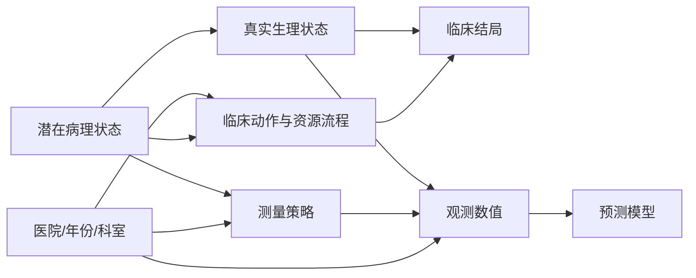

# 医学时序预测中的生理状态与记录过程分解：初步研究计划

**版本：** v0.1 初步计划

**编制日期：** 2026-10-31

**状态：** 研究设计草案；尚未锁定公开数据队列、标签、分析代码和主结果

**目标：** 在 2027 年 8 月前完成并投稿一篇医学时序预测方法学论文，研究 EHR 时序模型在跨医院、跨时间和观测策略变化下，分别依赖患者生理信号与测量/记录/临床流程信号的程度。

**推荐论文题目：** *What Does an EHR Time-Series Model Learn? Quantifying Physiological and Measurement-Process Dependence under Hospital Shift*

**总体路线：** 以公开多中心数据完成大样本机制实验，以 MC-MED 完成受控观测过程敏感性 benchmark，以 GAM/GD 和 MIMIC 流感队列作为真实临床案例验证。论文不以构建大型流感数据库为前置条件，也不以新网络结构或强化学习后训练为主贡献。

**执行原则：** 先锁定问题、数据、时间窗、结局和分解指标，再运行主实验；所有未执行的项目只写为计划，不写成结果。

---

## 1. 研究问题

### 1.1 主问题

在电子健康记录时序预测中，模型的预测信号有多少来自患者的潜在生理状态，有多少来自测量频率、缺失模式、时间间隔、医院、科室、编码方式和临床流程？当医院或记录策略改变时，哪一类信号保持稳定，哪一类信号导致迁移性能和校准下降？

### 1.2 研究对象的重新定义

本计划不把“患者生理状态”和“医院记录偏差”视为二元且互斥的对象。测量过程可能是患者病情的代理变量：病情越重，临床人员可能越频繁地测量。因此，计划区分三类信号：

1. **生理信号：** 体温、心率、呼吸频率、SpO₂、血气和实验室结果等与患者状态直接相关的数值。
2. **观测/流程信号：** 测量是否发生、测量次数、距上次测量的时间、医嘱和护理记录频率、科室和设备来源等。
3. **标签/编码过程信号：** ICU 转入、插管、诊断编码、出院记录和其他受医院资源与流程影响的结局或代理变量。

论文的目标是量化三类信号对预测和迁移的贡献，而不是证明某一类信号在所有场景中都“错误”。

### 1.3 因果和数据生成框架

观测数据可写成：

\[
X_t = g(P_t, M_t, H, \varepsilon_t), \qquad Y = h(S_{0:T}, A_{0:T}, H, \eta).
\]

其中，模型实际接收的是数值、缺失指示、时间间隔和记录来源的混合物。该框架要求主实验同时报告内部性能、跨域性能、校准漂移和患者级预测漂移。

---

## 2. 当前证据和研究成熟度

### 2.1 已完成的证据

| 证据 | 当前结果 | 能支持的结论 | 不能支持的结论 |
|---|---|---|---|
| GAM/GD 15 变量医院分类 | 医院分类 AUROC 约 0.709；呼吸频率、心率和记录覆盖差异明显 | 两院的记录分布和观测过程不同 | 模型一定使用了医院偏差 |
| GAM→GD 初始预测 | GAM 161 名患者、163 次住院、约 10 个事件；GD 约 292 次住院、38 个事件；GD 多数只有 3–5 次记录 | 小样本真实跨院迁移中存在时间、标签和稀疏性问题 | 复杂时序模型优于逻辑回归 |
| MIMIC→GD A4 桥接 | 652 例、108 个训练事件；GD 逻辑回归 AUROC 约 0.656–0.682，O/E 约 0.70–0.76；GAM 截距重校准后 GD O/E 约 0.88 | 外部迁移存在排序和概率尺度漂移 | 已完成临床确认性验证 |
| MC-MED 观测删减 benchmark | 5,236 例测试集；drop40 后多个模型 AUPRC 下降约 0.02–0.03；个体概率漂移和翻转率明显；seed 波动大 | 模型对观测稀疏化敏感，群体指标可能掩盖个体不稳定 | 随机删除等同真实医院的信息性缺失 |
| 数据标准和 flucase | 已建立对齐、规则集、质量成绩单、复核系统和版本锁定流程 | 数据治理和复现基础较好 | 当前数据已达到确认性研究标准 |

主要材料：

- [医院实验进度](../../result/阶段汇总与交接/实验进度.md)
- [A4 桥接重跑结果](../../result/医院队列与终点/A4桥接_只用编码队列重跑_结果_20261030.md)
- [MC-MED 观测删减 benchmark](../../result/观测过程建模/mp_benchmark_v1_三模型结果报告_wangyiming_20261021.md)
- [数据质量成绩单](../../docs/数据标准/质量验收/质量成绩单_std_v3_20261031_4.md)
- [公开流感数据集调研](../../research/数据集资源/influenza-datasets-20261030/report.md)

### 2.2 当前成熟度判断

| 维度 | 判断 |
|---|---|
| 问题新颖性 | 高；“记录过程依赖与跨院可运输性”比单纯模型比较更有价值 |
| 数据工程 | 中高；标准化、锁定和质量检查已经成形 |
| 机制证据 | 中；已有医院可识别性、随机删减和迁移漂移证据 |
| 因果可识别性 | 低到中；尚未完成 P-only/M-only 和受控策略替换 |
| 临床确认性 | 低；本地事件数少，标签和时间定义仍不完全对称 |
| 投稿准备度 | pilot 阶段；尚未形成冻结的主表和确认性主结果 |

---

## 3. 预注册假设和估计目标

### 3.1 主假设

**H1：观测过程具有独立预测信号。** 在相同任务和模型结构下，M-only 相对于患病率基线具有可测量的判别能力；其信号在跨医院或跨时间测试时下降更明显。

**H2：观测过程增加内部性能，但可能损害迁移。** P+M 相对于 P-only 在内部测试中可能提高判别或校准，但 P+M 的跨域性能下降和校准漂移不小于 P-only。

**H3：记录策略替换会改变患者级预测。** 在固定生理数值轨迹的情况下，仅替换测量频率、缺失模式或时间戳，患者级预测概率会发生系统变化。

**H4：生理型结局比流程型结局更稳定。** 新发氧合/器官功能恶化等生理型结局的跨院迁移性高于 ICU 转入、插管、住院去向和诊断编码等流程型结局。

**H5：再校准主要修复概率尺度，不能自动恢复排序能力。** 跨院截距重校准可能改善 O/E 和 Brier，但不一定恢复 AUROC/AUPRC。

### 3.2 建议的估计量

1. **记录过程增量：**
   \[
   RDI = Metric(P+M) - Metric(P\text{-}only).
   \]

2. **跨域迁移差：**
   \[
   TGap = Metric_{internal} - Metric_{external}.
   \]

3. **记录过程对迁移差的影响：**
   \[
   TGI = TGap_{P+M} - TGap_{P\text{-}only}.
   \]

4. **观测策略敏感性：**
   \[
   OPS = E\left[|p(X,M)-p(X,M')|\right],
   \]
   同时报告 P90 概率漂移和 prediction flip rate。

这些指标是本研究的操作性定义，不能被解释为完全识别的生理因果效应。

---

## 4. 论文证据结构

### 4.1 公开多中心数据：主证据

使用 MIMIC-IV、eICU 或 HiRID 完成至少一个大样本医学时序任务。由于公开数据库中流感病例数量和定义不一致，主任务允许使用呼吸恶化、脓毒症、器官衰竭或 ICU 结局；流感任务作为临床子组或案例分析。

要求：

- 至少一个开发库和一个外部库；
- 至少一个时间外推切分；
- 患者级切分，不能让同一患者跨集合；
- 公开数据不使用本地医院标签进行调参；
- 统一记录变量、时间窗和结局时间；
- 所有数据版本、查询脚本和概念映射写入 data manifest。

### 4.2 MC-MED：机制 benchmark

在已有观测删减实验基础上，增加以下受控干预：

1. 随机删除，作为 MCAR 基线；
2. 按经验测量频率删除；
3. 按医院或科室的通道策略重采样；
4. 保持数值不变、改变时间戳；
5. 保持患者轨迹不变、替换缺失掩码；
6. 删除医院、来源和流程字段；
7. 对 M-only 做标签置换负控。

已有的 BRITS、mTAND、Raindrop、FF-LSTM 和 GRU-D 结果作为补充 benchmark；主实验优先使用一套简单基线和一套不规则时序模型，避免模型数量掩盖输入分解问题。OPL-MT-MNAR 只有在核心实验显示需要更强观测过程建模时才加入。

### 4.3 GAM/GD：真实临床案例

本地数据只承担三项功能：

- 展示真实医院记录策略差异；
- 复现公开数据中观测过程敏感性的方向；
- 比较生理型和流程型结局的迁移差异。

本地结果不用于宣称复杂模型优越性，也不作为整篇论文唯一的统计证据。所有主分析使用患者级切分，明确区分测量时间、病历书写时间、医嘱时间和推断时间。

### 4.4 MIMIC 流感和外部数据申请

MIMIC 流感队列可作为流感案例；GIHSN、FLAGSTONE 等个体数据申请作为加分项，不作为投稿进度的硬依赖。CKB 更适合“谁会因流感住院”的人群风险研究，不作为本论文主要的住院后转重数据源。

---

## 5. 输入视图和实验矩阵

### 5.1 四个输入臂

| 输入臂 | 包含内容 | 目的 |
|---|---|---|
| P-only | 固定网格生理数值；不提供缺失指示、测量次数、时间间隔、医院和来源 | 估计生理数值的可迁移信号 |
| M-only | 缺失指示、测量次数、时间间隔、来源、科室/护理流程代理变量；不提供生理数值 | 估计记录过程的独立预测信号 |
| P+M | 生理数值和记录过程特征 | 模拟常规 EHR 模型 |
| P+M 去医院信息 | 屏蔽医院、科室、设备和来源字段 | 检验显式站点信息的影响 |

P-only 的插补方案必须在数据锁定前确定，不能用特殊缺失值或插补痕迹重新编码 M。所有标准化器、插补器和特征筛选只能在训练集拟合。

### 5.2 模型

主分析使用：

- 患病率基线；
- 逻辑回归；
- LightGBM；
- GRU-D 或一个已经在 MC-MED 上完成公平性检查的不规则时序模型。

BRITS、mTAND、Raindrop 等模型保留为 benchmark 补充，不把“哪个网络最好”作为主论文问题。

### 5.3 结局

优先使用两类结局：

- **生理型：** 统一规则定义的新发氧合恶化、器官功能恶化或呼吸恶化；
- **流程型：** ICU 转入、机械通气、住院去向、住院时长、诊断编码。

死亡作为远端硬结局单独报告，不能自动视为纯生理结局。ICU 和插管是临床动作，必须明确其受到资源、医嘱和禁忌条件影响。

### 5.4 数据切分和验证

每个主任务都至少报告：

1. 同院随机患者级测试；
2. 时间外推测试；
3. 留医院测试或跨数据库外部测试；
4. 仅重校准后的外部测试；
5. 按测量强度分层的性能。

同一患者多次住院或多次 landmark 必须使用患者级聚类 bootstrap，不能把每次记录当作独立样本。

---

## 6. 评价指标和统计方案

### 6.1 判别

- AUROC：主判别指标；
- AUPRC：在低阳性率场景中报告，并同时报告患病率；
- 灵敏度、特异度和固定灵敏度下的阳性预测值：只作补充。

### 6.2 校准

- 校准截距；
- 校准斜率；
- Brier score；
- O/E；
- reliability plot；
- ECE 只作描述，不作为主要校准结论。

主训练损失不得使用未经校准解释的加权 BCE 直接报告概率质量。若为了类别不平衡使用加权损失，必须在验证集进行预先登记的校准，并同时报告未加权或重校准结果。

### 6.3 稳定性和迁移

- Mean |Δp|；
- P90 |Δp|；
- prediction flip rate；
- TGap 和 TGI；
- M-only 的医院/年份可预测性；
- 策略替换后的 paired bootstrap 区间。

### 6.4 不确定性

- 患者级 cluster bootstrap；
- 至少 5 个训练 seed 的均值和标准差；
- 训练 seed 作为随机效应或在汇总中单独报告；
- 不以单个 seed 的最好结果作为主结论；
- 事件少于预设最低数量的分层只报告描述性结果，不做优越性检验。

### 6.5 泄露检查

主分析必须自动检查：

- 输入时间不晚于预测时点；
- 出院诊断、出院记录、未来治疗和未来编码不进入输入；
- 同一患者不跨训练、验证和测试；
- 预测时点已经发生的 ICU/插管不进入风险集；
- 变量筛选、标准化、插补和校准没有使用测试集；
- 标签定义不使用未来记录反向筛选样本。

诊断码和同次住院结局必须单独做 label leakage 敏感性分析。

---

## 7. 工作包和产出

### WP0：研究问题和引用清理

- [ ] 把研究问题、DGP、估计量和四个输入臂写成两页分析章程。
- [ ] 审核现有医学时序和 RL 调研中的 DOI、论文题名、年份和可核验程度。
- [ ] 清理未核验 DOI、摘要级未核验公式和无法确认的结论。
- [ ] 固定论文主线为观测过程依赖和跨院可运输性；RL/LLM 暂列为后续方向。

**产出：** `plans/医学时序预测_生理状态与记录过程分解_分析章程_v1.md`、引用清单和研究假设表。

### WP1：公开数据主基准

- [ ] 选定一个开发库和至少一个外部库。
- [ ] 冻结一个共享任务、索引时间、预测窗口和结局定义。
- [ ] 建立患者级、时间级和医院级切分。
- [ ] 生成 P-only、M-only、P+M 和去医院信息四套输入。
- [ ] 先运行患病率基线、逻辑回归和 LightGBM。
- [ ] 再运行一个不规则时序模型，保存患者级预测。

**产出：** data manifest、队列流程图、变量字典、泄露检查报告、基线结果表。

### WP2：观测策略干预 benchmark

- [ ] 在 MC-MED 上复现已有 random drop 结果。
- [ ] 增加经验测量频率重采样和跨策略重采样。
- [ ] 增加时间戳扰动和缺失掩码替换。
- [ ] 对每个干预计算 ΔAUPRC、ΔAUROC、Mean |Δp|、P90 |Δp| 和 flip rate。
- [ ] 用 paired cluster bootstrap 报告不确定性。
- [ ] 比较 P-only 和 P+M 的干预敏感性。

**产出：** 观测策略干预表、患者级漂移图、模型机制补充表。

### WP3：跨医院和跨时间迁移

- [ ] 完成同院、时间外推、留医院和跨数据库测试。
- [ ] 报告内部性能、外部性能、TGap、校准漂移和重校准结果。
- [ ] 进行医院/年份分类，评估观测过程可识别性。
- [ ] 按测量强度和缺失率分层报告性能。
- [ ] 不把再校准结果与重新训练结果混为一谈。

**产出：** 迁移性主表、校准图、医院/年份分层图。

### WP4：GAM/GD 临床案例

- [ ] 锁定一个本地主终点和一个流程型敏感性终点。
- [ ] 建立时间来源审计表，分开测量时间、书写时间、医嘱时间和推断时间。
- [ ] 以患者为单位切分和 bootstrap。
- [ ] 只做预先登记的 LR、LightGBM 和一个时序模型。
- [ ] 将本地结果写成方向性复现和数据生成过程案例。

**产出：** 两院案例表、标签和时间审计附录、真实观测策略对照图。

### WP5：论文和投稿

- [ ] 冻结主分析和所有主图表。
- [ ] 按 TRIPOD-AI/外部验证规范检查报告完整性。
- [ ] 生成数据卡、模型卡、分析代码说明和结果锁定记录。
- [ ] 先准备 npj Digital Medicine/JAMIA/MLHC 版本。
- [ ] 只有在完成多库外部验证、真实策略替换和临床效用分析后，才考虑更高门槛期刊。

**产出：** 预印本、投稿稿件、补充材料和可复现运行说明。

---

## 8. 时间表和阶段性停止条件

| 时间 | 目标 | 必须交付 | 停止或转向条件 |
|---|---|---|---|
| 2026-11 | 锁定问题、估计量、输入臂和引用 | 分析章程、引用审计 | 若无法统一任务定义，先缩小到 MC-MED benchmark |
| 2026-12 | 完成公开数据第一轮基准 | P-only/M-only/P+M 主表 | 若外部库变量无法对齐，改用时间外推和第二个公开任务 |
| 2027-01 | 完成观测策略干预 | paired drift 和 flip rate 结果 | 若随机删除无效，不能直接宣称记录过程稳定；继续做经验策略替换 |
| 2027-02 | 完成跨医院/跨时间迁移 | TGap、TGI、校准表 | 若没有外部迁移，论文降为单库机制 benchmark，不写跨院结论 |
| 2027-03 | 完成本地案例验证 | GAM/GD 标签与时间审计 | 若事件数仍不足，放入补充材料，不扩展模型复杂度 |
| 2027-04 | 冻结分析 | 主图、主表、补充材料目录 | 冻结后不按结果改主终点或主输入臂 |
| 2027-05 | 完成初稿和内部审阅 | 论文 v1、代码和数据说明 | 若主结果不稳定，先报告方法学阴性结果，不追加模型搜索 |
| 2027-06 | 预印本和投稿准备 | 投稿版、cover letter、审计清单 | 保留至少两个月修订缓冲 |
| 2027-07–08 | 投稿和返修缓冲 | 投稿记录、补充实验 | 不再把新数据申请作为主论文硬依赖 |

### 主论文最小可发表条件

主论文至少需要同时满足：

1. 一个公开大样本任务和一个外部或时间外推测试；
2. P-only、M-only、P+M 三个输入臂；
3. 至少一种非 MCAR 的观测策略干预；
4. 判别、校准和患者级漂移三类指标；
5. 严格的时间和标签泄露审计；
6. GAM/GD 或其他真实临床数据案例对机制方向的复现，或明确报告无法复现的原因。

如果只有本地 GAM/GD 小样本和 MCAR 随机删减，则只能形成探索性报告，不能作为“模型学习了医院记录偏差”的完整论文。

---

## 9. 主要风险和应对

| 风险 | 影响 | 应对 |
|---|---|---|
| 流感公开队列事件不足 | 无法训练复杂模型或做可靠外部验证 | 将主问题扩展为呼吸恶化/住院恶化，流感作为子组 |
| eICU 缺少流感病例 | 无法做跨库流感验证 | 使用通用临床时序任务验证方法学机制 |
| 真实缺失过程难以重建 | 策略替换不够接近医院现实 | 同时报告 MCAR、经验频率和真实两院描述性策略 |
| 本地标签不对称 | 结论混合测量偏差和标签偏差 | 生理型/流程型结局并列，建立时间来源审计 |
| 外部事件很少 | CI 很宽 | 只做方向性验证，使用公开大样本承担主推断 |
| 加权损失破坏概率解释 | 校准结论不可信 | 使用未加权概率损失或预先登记的重校准 |
| 模型数量继续膨胀 | 研究问题被模型比较取代 | 主文限制模型数，其他模型进补充材料 |
| LLM/RL 线分散精力 | 延误主论文 | 主论文完成前暂停新增奖励和零样本路线 |
| 引用存在未核验条目 | 审稿时可信度下降 | WP0 逐条核验 DOI、全文和支持范围 |

---

## 10. 明确不作为本计划主线的工作

- 不以构建大型全新流感数据库作为投稿前置条件。
- 不把新型时序网络结构作为主要创新点。
- 不在事件数不足时做复杂强化学习或治疗策略学习。
- 不把 ICU、插管和诊断码自动当作纯生理结局。
- 不用医院分类器的高 AUROC 直接证明模型发生了偏差学习。
- 不用单个 seed、单次内部测试或单个医院结果宣称模型优越。
- 不在看到结果后更改主终点、主时间窗或主输入分解。

---

## 11. 关键参考文献方向

以下文献用于建立理论背景和评价规范，投稿前需逐条核对最终版本、页码和引用范围：

1. Finlayson et al. *The Clinician and Dataset Shift in Artificial Intelligence*. NEJM, 2021. DOI: 10.1056/NEJMc2104626。
2. Verheij et al. *Possible Sources of Bias in Primary Care EHR Data Use and Reuse*. JMIR, 2018. DOI: 10.2196/jmir.9134。
3. Groenwold. *Informative missingness in electronic health record systems: the curse of knowing*. BMC Medical Research Methodology, 2020. DOI: 10.1186/s41512-020-00077-0。
4. Che et al. *Recurrent Neural Networks for Multivariate Time Series with Missing Values*. Scientific Reports, 2018. DOI: 10.1038/s41598-018-24271-9。
5. Song et al. *Cross-site transportability of a machine learning model for acute kidney injury*. Nature Communications, 2020. DOI: 10.1038/s41467-020-19551-w。
6. Yang et al. *Machine learning generalizability across healthcare settings*. npj Digital Medicine, 2022. DOI: 10.1038/s41746-022-00614-9。
7. Singh et al. *Generalizability challenges of mortality risk prediction models*. PLOS Digital Health, 2022. DOI: 10.1371/journal.pdig.0000023。
8. Shashikumar et al. *COMPOSER: a unified framework for detecting distribution shift and uncertainty in clinical prediction*. npj Digital Medicine, 2021. DOI: 10.1038/s41746-021-00504-6。
9. Ramadan et al. *Diagnostic Codes in AI Prediction Models and Label Leakage of Same-Admission Clinical Outcomes*. JAMA Network Open, 2025. DOI: 10.1001/jamanetworkopen.2025.50454。

---

## 12. 当前下一步

1. 在本计划基础上冻结一页版研究章程：主任务、主结局、P-only/M-only/P+M 定义和主要估计量。
2. 对 `research/` 下现有调研中的引用逐条做 DOI、全文和证据等级审计。
3. 选定公开数据主任务，优先运行逻辑回归、LightGBM 和 M-only/P-only 分解。
4. 修正 MC-MED benchmark 的概率评价口径，单独报告 seed 波动和校准结果。
5. 暂停扩展 RL、零样本和大模型实验，直到主问题的公开数据基准完成。
6. 主分析执行完毕后，再决定是否把 GAM/GD 案例扩展为单独的流感临床论文。

