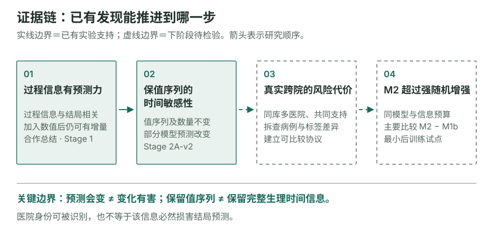
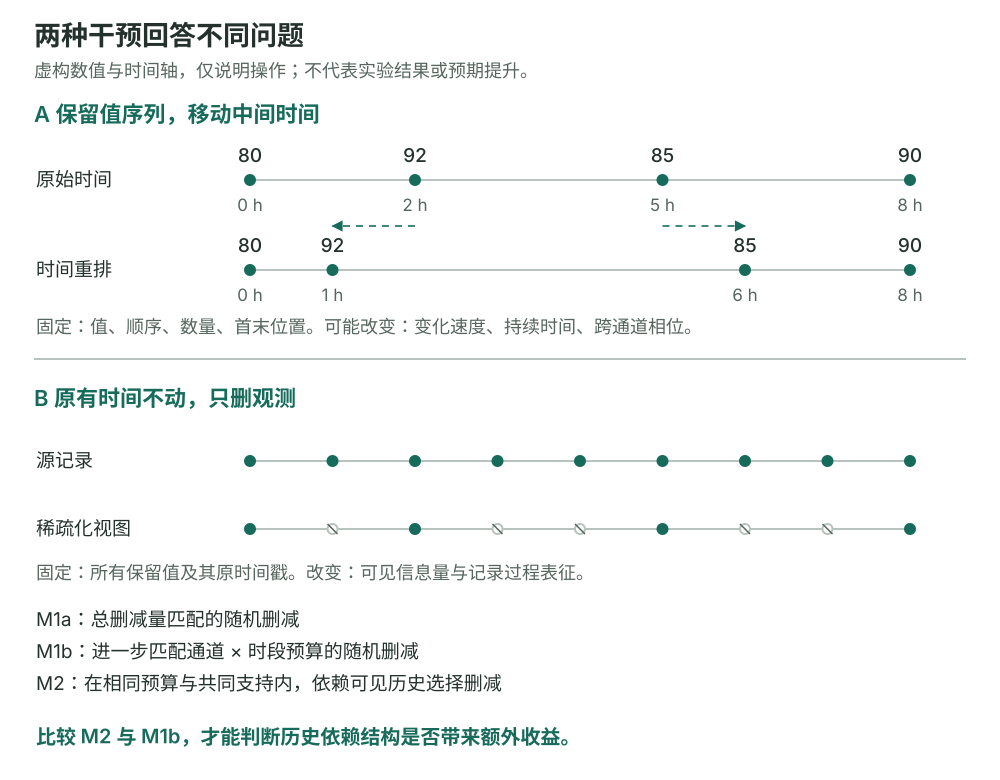
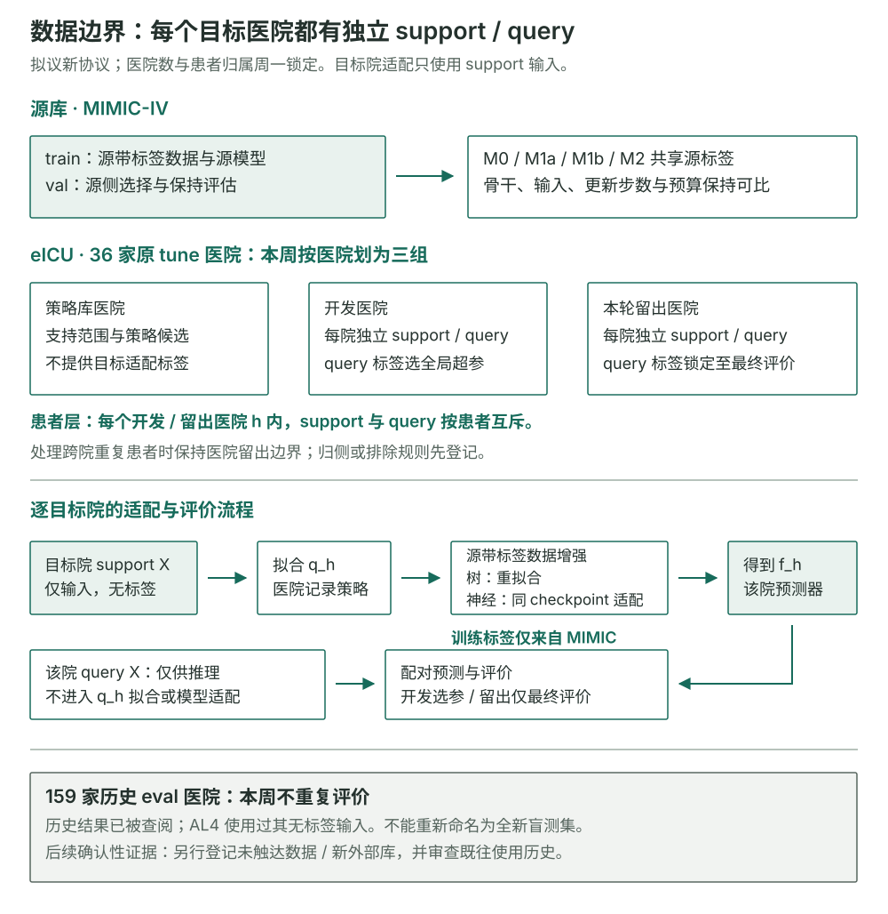
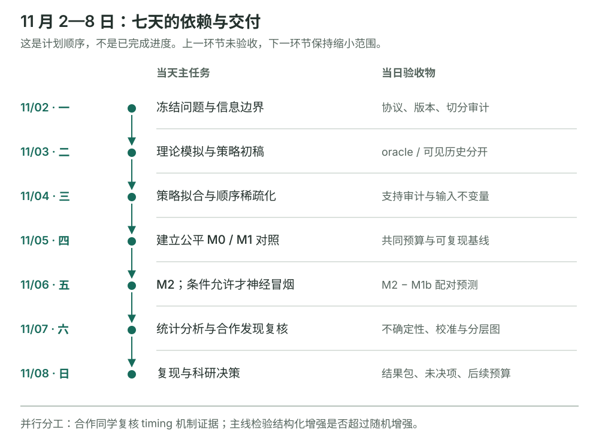
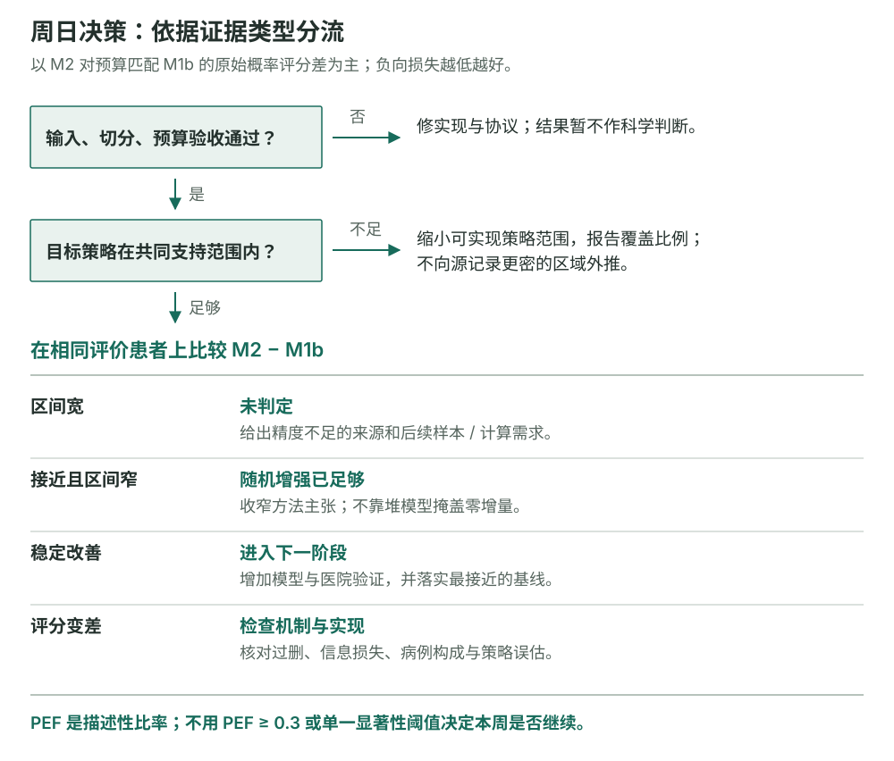

# 从记录时间敏感性走向观测策略后训练
## 2026 年 11 月 2—8 日详细研究计划

**编制日期：2026-10-31｜依据：v1.1、服务器只读审计、合作同学 MC-MED 阶段总结与 8 篇核验文献**

这周最值得完成的工作，是把已有的“记录过程有预测信息、模型会对时间与密度变化作出反应”，推进为一个可复现的方法试点：**在同一任务、同一训练预算和同一删观测预算下，历史依赖的策略增强，是否比强随机删减对照改善留出医院的预测损失。** 合作同学继续完善 MC-MED 问题发现证据；你的主线集中于多医院后训练。两条线在证据规范上合并，在任务和效应量上分别报告。

本文是下一周可执行的研究建议，不是新实验已经完成的报告。服务器检查只读代码、协议、锁定记录和聚合产物，没有读取患者数据，没有启动训练。文中的真实结果均标来源；预期结果均以情景和验收物表述。涉及队列、标签、切分、主要指标的新决定，周一执行前由研究者锁定。[E01][E12]

### 阅读路线

- 先读 §1–4：已有成果为什么有价值，哪些环节仍缺证据。
- 按 §5–9 执行：实验定义、分工、逐日任务、论文阅读与统计规则。
- 周日用 §10–12 决策：结果如何解释、下月如何推进、需要锁定什么。
- §13–14 提供代码地图、交付清单和可追溯来源。

## 1. 当前处于哪一步

**项目已经具备问题发现、数据管线和后训练经验；尚缺的是“真实记录策略结构带来独立方法收益”的受控证据。** 现在扩大模型清单或建设大型新数据集，会分散对这一关键缺口的检验。



*图 1｜前两段已有证据，后两段是本周要补的连接。记录过程有信息、模型敏感、预测受损和方法有效，是四个不同命题。不能从预测漂移直接跳到有害医院偏差。*

| 研究命题 | 现有证据 | 当前判断 | 本周应补什么 |
|---|---|---|---|
| 观测过程携带结局相关信息 | 9 月 recency 增量；合作 Stage 1 Process-only 和 Combined | 已有多种操作化证据，任务不同 | 合作侧冻结输入定义和队列清单 |
| 部分模型对记录时间/密度敏感 | 10 月 drop40；合作 grid timing swap | 有受控敏感性证据，仍非纯政策识别 | 输入实际变化、剂量、校准和配对损失 |
| 真实医院记录差异造成可缓解的损失 | F2 特征语义协调、F3 密度错配、跨库下降 | 有线索；病例构成、标签与采集来源也在变 | 同库多医院、支持审计和预先锁定评价 |
| 结构化策略后训练优于一般增强 | 现有 toy，P1 后训练经验 | 未建立；toy 有 oracle 信息与预算问题，P1 是另一任务 | M2−M1b 公平比较及模拟恢复实验 |
| 能面向新医院稳定推广 | eICU 历史外评、两院数据资产 | 可复用但已有触达，不是全新盲测 | 本周探索试点；后续另锁新外部确认 |

一个合理的论文中心命题是：**“在可见历史和共同支持限制下，针对记录过程变化构造训练视图，能否以少量后训练改善临床时序预测的跨医院迁移能力？”** “患者生理状态还是医院记录偏差”保留为动机，不能写成互斥二选一。记录过程既可能携带医生对病情的判断，也可能携带不能迁移的制度信号。[E02][E05][S004]

## 2. 合作同学文档带来的新证据与修订

以下数字来自用户提供的《MC-MED：从“缺失敏感性”到“Measurement Timing Reliance”的问题发现阶段总结》。已读取全部 33 个正文段落与两张表；其引用的 `FINAL_COMPLETE_RESULTS`、运行 manifest 与 v2 原始验收产物本轮未独立核查。因此这里准确标注为**合作摘要报告**。[E02]

### 2.1 Stage 1 已有清楚的增量信号

| 模型 | Value-only AUPRC | Process-only AUPRC | Combined AUPRC | Combined−Value-only |
|---|---:|---:|---:|---:|
| Logistic Regression | 0.2621 | 0.1786 | 0.2733 | +0.0112 |
| XGBoost | 0.3099 | 0.2003 | 0.3201 | +0.0102 |
| LightGBM | 0.3028 | 0.2037 | 0.3253 | +0.0225 |

Stage 1 test prevalence 为 12.03%。LightGBM 的增量 95% CI 为 **[0.0114, 0.0341]**；其他两项差值是本表直接相减，摘要没有提供对应区间。Process-only 高于患病率参考线，说明“怎么测”有预测信息；Combined 增量说明当前数值摘要没有穷尽这些信息。它们都不能证明该信息是有害偏差。[E02，表 1、P9–10]

**Value-only 的正确名称是“观测值特征臂”。** 采到哪些值、极值是否出现、插补持续多久，都已受记录过程影响。把显式 count/gap 去掉，并没有获得纯生理表示。strict-dense 筛选将 test 从 5,236 缩至 372（约 7.1%），还会选择密集监测患者；降为补充分析是合理的。[E02，P11–12]

### 2.2 v2 的改进是实质性的，但要精确命名

在模型实际 grid 上固定值列表、顺序、有效数和首尾 occupied bin，并使 collision、aggregation、dropped value 均为零，排除了旧 raw-level swap 的重要实现混杂。这应作为可复用的工程成果保留。[E02，P13–21]

更准确的名称是：**保留实测值序列的时间扰动（value-sequence-preserving timing perturbation）**。保持值列表不等于保持完整生理动态。例如 SpO₂ `[98,90,96]` 的首末时间固定为 0、60 分钟，把中间值从第 10 分钟移至第 50 分钟，下降速度、恢复速度、前向填充后的低氧持续时间都改变；逐通道移动还会改变不同生命体征的同步关系。该例为解释性虚构示意，不是患者记录。



*图 2｜上部改变记录时间而保留值序列；下部保持已有记录的值与时间戳，只删除一部分记录。两者回答不同问题。前者是时间结构敏感性，后者是信息可见性变化下的增强与适应。*

| 管线（合作摘要） | Original AUPRC | v2 MPAD | 决策不一致率 |
|---|---:|---:|---:|
| XGBoost | 0.3167 | 0.0005 | 0.45% |
| LightGBM | 0.3147 | 0.0010 | 0.57% |
| BRITS | 0.3141 | 0.0177 | 6.20% |
| GRU-D | 0.2985 | 0.0188 | 6.14% |
| OPL structured-only | 0.2939 | 0.0138 | 4.91% |
| FF-LSTM | 0.2755 | 0.0099 | 3.73% |
| MIRA-Large | 0.2180 | 0.0128 | 7.86% |
| VIMTS-Adapter | 0.1586 | 0.0177 | 15.14% |
| TimesFM 3.0 | 0.1456 | 0.0192 | 10.47% |
| mTAND（不同队列，单列参照） | 0.2731 | 0.0012 | 0.52% |

**表的阅读边界：**主要 v2 比较使用 N=1,328、224 阳性，事件率约 **16.87%**，与 Stage 1 的 12.03% 不同；mTAND 使用 N=4,684。摘要未给每行完整分母、seed 与区间，不能据此做严格架构排名。MPAD 的精确定义也需从评价代码确认，暂保留原缩写。[E02，表 2、P23]

这张表最值得追的是 **GBDT 与时序管线的输入差别**。若树模型只看均值、极值、首末值、计数与端点 recency，swap 可能根本没有改变其输入；此时低漂移首先是表示不变性，不能直接归因于树的架构优势。相反，时序模型确实读到变化速度，敏感性可能包含合理响应。

SpO₂ 单通道扰动在 GRU-D、OPL、BRITS 中 MPAD 最大，值得重点复核；但应匹配每通道可扰动人数、位移幅度和观测数。阈值附近 Q1 的翻转率约 18.3%–21.0%，远端 Q4 近零，部分可由更小的 margin 直接解释。**翻转含错误→正确，也含正确→错误；绝对漂移不区分这两者。**[E02，P25–26]

### 2.3 合作线本周补齐七项聚合证据

建议由合作同学负责已有 3–4 个代表管线（LightGBM、GRU-D、BRITS、OPL），不再扩成新的全模型训练矩阵。以下是建议分工，尚未向合作人发送或代其承诺。

| 聚合交付 | 必须包含 | 解决的歧义 |
|---|---|---|
| 队列与任务 manifest | t0、输入/标签窗、患者/就诊数、阳性、split/hash、筛选漏斗 | 5,236、1,328、4,684 是否可比；任务是否沿用 decomp_60 |
| 模型输入地图 | 特征列/张量、mask/time/gap、变换后变化比例和最大差 | GBDT 是否实际看到扰动；能否谈架构差异 |
| grid 验收表 | 保值/序/数/端点，通过率；碰撞/聚合/丢值；identity 与可逆时的往返校验 | 实现是否真的只改变登记的部分 |
| 扰动剂量表 | 可扰动率、实际未变率、位移/gap 分布、共同与逐通道变换 | 效应是否只是扰动强度和覆盖率不同 |
| 配对损失表 | 原始/扰动 AP、AUROC、Brier、log loss；带符号 Δp、尾部漂移、区间 | 敏感性是否伴随预测损失增加 |
| 校准与翻转表 | 损失/pos_weight、Val 校准、阈值来源、两方向与对错翻转计数 | MPAD 是否受概率尺度影响；翻转是否有害 |
| 选择与重复性表 | 全 test vs 机制子队列的差异；患者重复、seed、共同交集 | 选择偏差与不确定性的统计单位 |

两个小控制足够：**identity/可实现往返**，以及**共同单调时间变换与逐通道变换**。共同变换可减少跨通道顺序被破坏，但仍改变物理时间速度，不能改称纯政策干预。详细核对项见本目录 `colleague_design_review.md`。

## 3. 服务器实验到底说明了什么

### 3.1 数据与测试集使用历史

| 资产 | 已核实规模与口径 | 对本周的实际作用 | 要补的限制 |
|---|---|---|---|
| B1v2 MIMIC-IV | 成人 ICU ARI；6–72h 每6h landmark；过去24h输入，未来24h Y24；37,252 landmarks、6,023 stays、5,531人；患者 train/val/test 3,877/549/1,105 | 复用源模型、小时视图与标签管线 | 病毒检测入组、6h气切与DNI规则仍有复核项；ARI可使用全住院诊断，要标“回顾性队列”并登记 `ari_known_at_t0` 审计 |
| V2 eICU | 195院、9,398人、64,338 landmarks、4,492阳性landmarks；36 tune院与159 eval院 | 36院内新协议开发与医院留出试点 | 26人跨原tune/eval；死亡组分与MIMIC不同；流感病例为0，不能写流感专属外推 |
| eICU 小时视图 | 原始小时 `last,n,t_last_min`；体征/化验采用不同LOCF上限 | 构造删观测视图的起点 | 自动周期采集与MIMIC人工chart来源不同；现有表没有真实钟点/完整采集来源，不可直接拟合昼夜开单策略 |
| 历史测试集 | B1年份组2020–2022已进入旧随机train/val/test；eICU eval已反复报告，AL4还用其无标签X | 历史比较与探索复用 | 不称全新时间集或未触达外部集；本周不重开159院评价 |

B1 的 L1–L5 已报告为零，是其登记检查通过，不代表所有临床口径和研究设计问题都消失。eICU 26名重复患者是原方案允许的事实；新方案应由研究者锁定跨侧重复患者归属/排除规则，不能静默修改旧分析。[E03][E04][E07]

### 3.2 现有实验的价值和误读风险

| 实验 | 核实的关键结果 | 可复用价值 | 需要纠正的推论 |
|---|---|---|---|
| F2 特征语义协调 | count由原始记录条数改为有观测小时数，LR外AUROC约0.609→0.673，校准斜率0.08→0.50；LGBM近不变 | 证明相同列名未必是相同采集语义，支持先审计M特征 | 不能把全部改善归因为去除医院偏差 |
| F2 表示比较 | 手工LGBM在≥65岁分析中源test AUROC0.755、eICU0.715；12种冻结嵌入外部ΔAP −0.013至−0.054 | 强树模型必须保留；不宜直接扩冻结嵌入 | F2两组都保留过程/化验/静态特征，并非P-only/M-only分解 |
| F3 密度压力测试 | 每变量仅1值时AP约降1/3；密度错配额外损失LR0.058、LGBM0.034 | 训练/部署记录密度应匹配，随机删是必要强基线 | 原“基础模型稀疏优势”假设未成立；不能只报符合叙事的结果 |
| AL1/AL4 | 医院身份可被记录过程识别；AL4最好弱骨干AP约0.169，低于手工LGBM约0.201 | 提供候选域适应实现与负结果 | 降低医院可识别性不等于改善结局；AL4使用含eval的无标签目标X，是直推式适应 |
| P0/P1/P2 | 点误差奖励使80%覆盖率0.741→0.09–0.13，energy约0.773；P1 RL较SFT WQL仅改善约0.4%，外部无差p=0.78 | proper loss经验、训练管线和优化经验 | P1是48h上下文→12h轨迹预测，不是Y24分类；不能证明记录策略后训练已经有效 |
| 10月 MC-MED | 5-seed drop40 ΔAP：FF-LSTM−0.016、GRU-D−0.036、BRITS−0.033、mTAND−0.024、Raindrop−0.024 | 密度敏感性与管线验收储备 | 不用旧3-seed摘要替代更新表；BRITS continuous5min ΔAP为−0.011，不能继续称近零 |

这些数字分别来自不同任务、队列和指标，不合并成同一“提升排行榜”。服务器方法审计还确认：F2 只替换部分数值摘要，仍保留 `n_obs/hours_since_last/missing`；MC-MED 实际 CSN 行 bootstrap 与 F2 患者聚类不同，ECE也分别为等宽与等频10箱。[E06][E07]

**概率尺度是一个必须先处理的实现问题。** 10月 MC-MED 训练使用 `pos_weight=(N−pos)/pos` 的加权BCE；15个已报告run原始Brier为0.183–0.231，差于患病率常数约0.106。这不会自动否定排序能力，但意味着原输出不宜直接解释为风险。合作 v2 是否沿用同一损失需核实；如要比较概率漂移，只在 Original Val 拟合一次校准器，再同时用于 Original/swap，并保留原始输出结果。[E06][E07]

### 3.3 9月、10月与合作v2必须分开引用

| 批次 | 任务与时间窗 | 分母 | 最可用的结论 |
|---|---|---|---|
| 9月官方test | 到院2h的 `dispo_T3`，正类非Discharge；并列 `decomp_D120` 为之后120min恶化 | dispo test 10,477 visits、4,321阳性 | recency超出presence/values/去重N/S有增量：LR +0.00772 [0.00544,0.00995]；LGBM +0.00469 [0.00257,0.00677] |
| 10月benchmark | `decomp_60`；输入0–15min，标签(15,75]min | test 5,236 visits，约12%阳性 | 随机删减/稀疏化改变表现与个体分数，模型反应不同 |
| 合作Stage 1/v2 | 摘要与10月分母有关联，但没有完整任务manifest | Stage1 5,236；v2主要1,328/224；mTAND4,684 | 过程增量与保值序列时间扰动；精确任务、队列和统计对齐列为周一交付 |

9月只可在对应模型范围内说recency增量。预写的实质阈值是 CI下界>+0.005：LR达到，LGBM未达到。其 **test shift轨因与dense使用相同X而失效**，不能作为密度错配稳健证据；matched轨相对增量保留时，绝对AP仍下降约0.002–0.003。`decomp_D120` test只有183阳性，校正后未判定，不能据此说无效。正式 `TEST_PREREG.md` 已定位，部分签署/验收勾选不完整；找到文件不等于独立验证了完整签署链。[E05]

### 3.4 两院数据是临床审计资产，暂不承担主验证的功效

最新 `std_v3_20261031_5` 中，GD/GAM确诊且≥60岁住院为355/129；O1主口径事件23/10；人工复核为0。住院人口学与主索引较完整，质量成绩单总体“不合格”主要受GAM门急诊年龄/性别覆盖仅1.9%影响，不能说住院底座整体不可用。[E08][E09]

更直接影响本研究的是来源与时间语义：GAM/GD SpO₂覆盖约51.4%/16.0%；GAM氧疗多来自护理/病历文字，GD主要来自医嘱；GAM吸空气状态近乎全未知，GD又多为医嘱推断，不能当实测空气状态。GD也不再是未使用过的外部集。**本周给医院线设维护上限，优先做标签/时间来源审计，不等大型数据集建成才推进论文。**[E08][E09][E10]

建议研究者与临床合作方在既有审批下选取约20份记录做本地核对，覆盖疑似阳性、阴性、时间不确定及氧疗来源不一致；记录一致性与错误类别。这个数是工作量建议，不是精度或功效论证，抽样不具代表性，不能据此估计全库标签准确率；只回传聚合结果。

## 4. 对 v1.1 的八项实质修订

| v1.1中的主张/路线 | 本次修订 | 对下周的影响 |
|---|---|---|
| PEF解释跨院损失中策略贡献 | 只保留描述性比值；分子分母估计对象可不同，非因果归因或性能上限 | 主报原始配对损失差；分母近零时不强算，不以PEF≥0.3作为门槛 |
| 简单 `min(1,p_target/p_source)` 移植 | UCAR下已有先行方法；一般历史依赖/MNAR不自动成立 | 先做已知生成机制模拟与支持审计，再做受约束增强 |
| 只删不加就是主要新意 | Zhou 2023 §6已提出相对缺失率再掩码 | 新意必须来自时序历史/联合结构、可实现边界和后训练独立收益 |
| 同患者多视图应预测相同 | 删除信息会使合理后验回缩；时间重排也可改变病程语义 | M3一致性后置；先防止“恒常输出最稳健” |
| 无标签医院描述子代表纯策略 | 同时混入严重度、病例构成、采集设备和流程 | 分开支持集/查询集，登记直推或归纳协议；不使用纯策略措辞 |
| 2020–2022可直接作未用时间集；159院是新测试 | 已有训练/评价或无标签触达历史 | 本周明确探索性；未来确认需另定新数据/真正未触达范围 |
| SFT已经证明Y24后训练有效 | P1的估计对象是轨迹分布；分类后训练尚未验证 | 复用方法经验，重新建立同checkpoint分类试点 |
| isotonic不改变AUROC；稳定报警率适合RL | 仅严格递增校准保排序；isotonic并列可能改变AUROC。不同患病率不宜强制同报警率 | 明确校准规则；M5/RL不进本周关键路径 |

对应依据包括服务器审计、模拟源码与外部方法全文。Zhang & Li 2026是邻近预印本，但本轮读到的正文缺少足够队列/训练细节；不能以其汇总数值作已复现标尺。Jeanselme 2025总体transfer loss中DeepJoint与Feature均为0.011，不能简单写成联合建模已显著解决跨院偏移。[E01][E07][E11][S001][S002][S003]

## 5. 本周唯一主问题与最小实验

### 5.1 三个可证伪的问题

**H1：方法前提。** 源记录与目标医院无标签支持集，在可比较的记录语义下存在可建模的策略差异，并有足够共同支持。若主要差异是目标更密、设备不同或未观测临床判断，删观测无法恢复目标全分布，应收窄适用范围。

**H2：主要方法问题。** 同样删量、视图数、训练预算与目标信息下，M2在留出医院的查询患者上，比M1b获得更低Brier。**本周预定LightGBM为主要表格骨干，LR为工程诊断，神经结果为条件性探索；不在两者中择优充当主结果。**主要效应定义为**未校准原始概率**的 `ΔBrier = Brier(M2) − Brier(M1b)`，负值有利。log loss是关键一致性指标；AUPRC/AUROC和校准辅助解释。

**H3：保留有用信息。** M2的收益不以源域明显退化、概率坍缩或少数医院极端恶化为代价。报告源Val与目标各院原始损失、概率分布、校准及事件组件；不能只追求更低MPAD或医院分类接近随机。

这是方法可行性试点，周日不要求预先承诺正结果或统计显著。所有主要比较、方向、seed和选择预算应在评价前冻结。

### 5.2 冻结的任务范围建议

保留已有**成人ICU ARI、Y24、6–72h landmark、过去24h输入**作为试点，不在这一周同时扩全成人、换生理终点或修改风险集。Y24含IMV、升压药和死亡，前两项本身是治疗决策事件；应报告组件频数和组件分层结果，不能把跨库误差都归给输入测量策略。[E03][E04]

第一阶段用现有小时记录，不声称恢复原始连续生理轨迹。当前eICU钟点与细粒度来源未保留：先用**距ICU入科时间、变量、上一可见值、距末次记录时长、已有记录历史**；星期、真实clock time及原始采集类型只列扩展需求，取得并审计后才能使用。

### 5.3 方法矩阵：把训练收益与策略结构收益分开

| 臂 | 输入视图/适应方式 | 作用 | 本周状态 |
|---|---|---|---|
| B0 | 共同源模型checkpoint，零更新 | 衡量一般继续训练的收益 | 必须保留；树模型报告源训练版 |
| M0 | 原始记录视图，等更新步数的监督继续训练 | 隔离“多训练了几步” | 必做 |
| M1a | 总留存量匹配的随机删减 | 最简单增强基线 | 必做 |
| **M1b** | 患者×通道×粗时间段留存预算匹配，预算内随机选位置 | 排除总量及粗结构带来的优势 | **主要对照** |
| **M2** | 使用可见历史的条件策略删减；保留原时间戳 | 检验历史依赖位置选择是否额外有效 | **主要方法臂** |
| M3 | M2加一致性损失 | 需先证明哪些变化可以要求不变 | 只写设计，不承诺训练 |
| M4/M5 | 无标签环境条件化/RL | 分别需信息边界与临床效用目标 | 后置 |

M0/M1/M2默认使用同一未做类别加权的BCE，或预先锁定Brier；不在看到测试表现后择优换损失。原始视图与增强视图的混合比例建议先固定1:1，周一锁定；M0用等量identity视图，样本总权重不随视图数翻倍。LightGBM的identity臂也使用相同展开行结构，冻结分箱、叶节点最小样本/Hessian与行采样等设置，避免复制行改变正则效果；权重总和相同本身不足以保证训练等价。损失在增强训练分布上适当，不保证在任意医院自动校准。[S008]

**树模型和神经模型分两层理解。** LR/LightGBM用于低成本验证视图、强基线与信号；LightGBM若重新拟合，只能叫增强训练，不能包装为预训练模型后训练。GRU-D等序列模型须从共同源checkpoint开始，冻结同样的更新预算；若要主张TSFM后训练，必须后续补同一TSFM的B0/M0/M1b/M2，不能以换风险头或树模型替代。下周只有前置验收及时通过时才做一套神经冒烟/小规模试点，不再并行追12种嵌入。

### 5.4 公平比较的“九个相同”

所有可比较臂共享患者和标签、变量与预处理、神经初始化checkpoint、视图数量与样本权重、预先固定的更新步数、HPO次数与搜索范围、目标信息权限和校准/阈值预算。**每患者×通道×时段删量完全相同，仅要求M1b与M2；M1a只匹配总量，M0保持原始视图。** 神经臂使用共同固定步数并在相同登记步点评价，不允许各臂自行早停后还声称实际更新步数相同。LR/LGBM按同搜索预算与模型复杂度比较；若B0与M0都以相同算法重拟合且没有继续训练操作，两者合并为一个identity臂，不人为制造两行结果。

M1b可按M2实际实现的每患者×通道×粗时间段留存数进行随机重抽，形成更强的预算匹配对照；但这样继承了M2的粗预算信息，所以其比较对象准确地是**预算内的历史依赖位置选择**。需另报M1a，以看总量、粗结构和条件位置三层各增加多少。时间段必须预先固定，不为放大M2优势而事后改粗细。

## 6. 策略估计、支持与信息隔离

### 6.1 医院、患者、标签的三层边界



*图 3｜36家原tune医院用于登记新探索协议，159家历史eval本周不重评。即使重新切分36家，也不能抹去历史使用；“新留出”只表示本轮不再用于选择。*

建议把36院按医院划为策略库、开发和本轮留出三组；具体院数不在未知事件分布时拍定，周一依据**聚合规模、来源、事件可评性**完成分层并冻结。每个需要目标适应的医院，再按患者划为无标签support与query。**本周主模式是每个目标医院单独适应：support的X→估计该院q_h→在MIMIC带标签源样本上生成该院的M1/M2视图→从共同源模型得到医院专属f_h；目标support标签不进入训练。** 策略库医院用于共享策略先验/收缩估计；开发query标签只选择跨院共享的超参和固定校准方案。本轮留出query的X仅作冻结模型推理，Y仅作已冻结比较，不进入拟合、更新或选择。

为了控制工作量，周一按支持/事件规模等聚合条件预先选择**2–4个本轮留出目标医院**完成全部表格比较，报告筛选与覆盖；不按方法效果挑医院。神经分支若启动，先固定其中一个目标医院做工程试点，不能据此称已完成多院神经验证。

这叫**独立支持患者上的无标签目标适应**。另做可选的无目标support归纳版本时单列结果；若把同一批query X用于估策略，则是直推式适应，不能混写。跨医院重复患者以patient为不可拆单位处理，且同时保持医院留出：可按医院—患者连通组划分，或预先剔除跨侧患者/仅保留指定侧记录并丢弃其另一侧记录；不能把留出医院的记录搬入开发。源患者所有landmark及增强视图保持同侧；报告被影响人数，不根据预测表现选方案。

所有36院既往已是开发资源，因此这仍是**探索性方法试点**。未来确认需新外部库或明确未参与开发的独立数据；MIMIC的跨患者平移日期也不能直接当真实共同日历来切时间。[E03][E04][E07]

### 6.2 拟合的不是“纯医院政策”

先在唯一patient/encounter×hour上构造记录过程和在险分母，不把每6h landmark展开后重叠的24h窗口重复计为独立小时。构造每变量每小时是否有真实记录的指示 `R_vt`；仅使用t之前可见历史，拟合source/target的离散记录概率。首版优先简单、可解释的正则化logistic/hazard模型，用变量、elapsed hour、last observed value、delta、过去计数；高维患者ID、未来Y、当前未观测真值禁止进入。

策略模型用log loss/Brier、分层可靠性检查，评分在source-val与support内部患者留出/交叉拟合上完成，不能只报告拟合内表现；分布验收至少包含：每通道留存率、零观测窗口、gap/recency分布、距入科时间分层、成组共测频率。只匹配平均缺失率不代表重现联合开单结构。人口学和最近严重度分层用于检验病例构成混杂；隐含医生担忧仍未观测，不能宣称已消除MNAR。

### 6.3 thinning的实现与理论界限

候选顺序接受率可写作：`a_vt = min{1, q_target(R_vt=1 | retained history) / q_source(R_vt=1 | source history)}`，只在source已有真实记录时决定保留。**这是待检验的构造，不是一般MNAR下已证明的目标分布恢复公式。** 分母来自源可见历史，分子来自删后历史，不能混用；删去记录后，后续策略状态也随之改变。当前toy用完整未掩码轨迹估严重度，现实不可用，必须分开oracle与observed-history版本。[E11][S003]

处理边界时，报告目标更密的变量/时段/患者比例、q_source近零比例、截断/限制支持后的覆盖范围。`min(1,·)`不能把目标更密的区域魔法变成可实现。支持审计须按预先定义的在险患者小时计算分母，不能只在成功匹配的已观测点上汇报“通过率”。还要检查q_target被用于源删后历史时，历史协变量是否落在目标support覆盖范围；目标强度不大于源强度只是可实现条件之一，不等于病例构成/历史状态共同支持。

建议在encounter×channel×view层面顺序生成共享小时mask，再切出各landmark回看窗，保证重叠窗口来自同一增强记录流；随机源不随landmark另起。窗口前历史只使用此前可见且在已锁规则允许范围内的记录，明确起始状态、LOCF上限与首次记录处理。若工程上退回每landmark独立增强，则登记为独立样本视图，不能称为一条一致移植轨迹。

所有删除发生在**LOCF之前的小时真实观测层**。随后从头重建last/summary、n、mask、delta和插补；不保留原生过程列混入变换视图。小时内只保留last的表无法支持任意原始事件删减；本周结论限定为小时级可见记录。

### 6.4 周二的合成实验不是展示漂亮提升

| 场景 | 生成机制与目的 | 期望验收，不是预设正结果 |
|---|---|---|
| Null | 两环境记录机制相同 | 真q已知且相等时全保留、过程不变；估计q误差造成的额外删减与正则收益另列 |
| UCAR、目标更稀疏 | 机制已知、维度独立且支持充分 | 复现理论可处理情形，目标统计在Monte Carlo误差内匹配 |
| 依赖可见历史 | 上次值/gap触发加测；分source/retained历史 | 比较正确顺序更新与错误固定历史，定位估计误差 |
| 隐状态触发 | 医生担忧/未测严重度决定加测 | observed-history与oracle差距被暴露，而非隐藏 |
| 成组开单/支持不足 | 变量联合采样；某些目标区域比source更密 | 边际匹配仍可能联合失配；明确不可生成区域 |

每场景报告过程统计误差、有效覆盖、预测Brier/log loss及运行成本；至少多个独立合成数据种子。oracle仅作为理想信息参照，不自动构成预测风险的数学上界或下界，也不纳入可部署算法。简单UCAR都恢复失败时，周三先修实现，不进入真实训练。

## 7. 下周逐日执行表



*图 4｜先锁协议与算子，再训练，再评价。GPU任务依赖工程门槛；合作证据整理和理论阅读可并行。*

工作量按**你是主要研究者兼主要工程执行人**安排：核心约32–36小时（在复用接口顺利的条件下），周五/六可选神经试点另加3–5小时；阅读已包含在每日时间内。合作同学约6–10小时补聚合证据、临床核对约2小时由可用人员承担，均为建议而非已经分派。最低路径为Null+UCAR、split/q/算子验收，以及预定2–4目标院上LightGBM的M0/M1b/M2固定预算比较；LR只做工程诊断。五场景、M1a、双骨干完整矩阵和神经分支为扩展项。若只能投入20小时或前置验收延期，保留协议、算子与失败定位，未完成训练明确列为下周延续，不为了交表跳过门槛。资源快照见§13，不能把两张GPU视为已预约。

### 周一 11/02｜锁定比较对象，避免先跑后改（5小时）

**输入：**v1.1、B1/V2队列报告、历史使用台账、合作摘要、Healthsheet。

**上午（2小时）：**写一页分析契约，列研究问题、Y24/risk set/landmark、输入层、M0/M1a/M1b/M2、主要ΔBrier、源/目标信息权限。核对26名跨原tune/eval患者的规则，新切分仅由授权执行者输出聚合审计；不读取病例。冻结36院分组办法、support/query患者规则、评价方向与未触达范围。

**下午（2小时）：**列已有可复用模块与缺失接口；用合作方的聚合manifest对齐3套MC任务，索取§2.3清单中的前3项。选择固定的3–4代表管线，明确本周不需新12模型benchmark。登记A档待锁事项，不用另一终点绕开问题。

**阅读（1小时）：**Agniel方法/结果 + Zhang&Li方法/复现信息；产出“过程信息≠纯偏差”与“最近邻方法差异”各半页。[S004][S001]

**交付/验收：**`protocol_v0.1.md`、`split_manifest`、`information_access.csv`、`run_matrix.csv`；医院/患者/landmark统计单位不混淆，query标签使用边界明确。不能锁定的临床口径保留为阻断相关正式运行的待决项；仍可推进虚构数据和模拟开发。

### 周二 11/03｜修复oracle模拟，开始策略审计（5小时）

**上午（2.5小时）：**将旧toy拆成生成器、oracle策略、observed-history策略、预算匹配随机对照、统一评分器；完成§6.4的Null与UCAR；时间允许再加入可见历史和隐状态场景。禁止用完整未掩码真值估现实策略。

**下午（1.5小时）：**从既有聚合/授权服务器统计生成候选策略特征字典；明确t之前历史、记录分母和每变量来源；初版q模型可在已锁support范围拟合。检查小时表能做什么，不能把clock time写成现成字段。

**阅读（1小时）：**Zhou §3–6尤其Algorithm 1；Veitch Definition 1.1/§3–4只提取条件。写“何时可恢复、何时只能作增强、何时应不变”三列表。[S003][S007]

**交付/验收：**`simulation_checks`、`policy_feature_dictionary.md`、`support_audit_v0.csv`；已知q的Null算子恒等、估计q误差单列，UCAR恢复误差有Monte Carlo解释，失败有定位。预期得到可实现边界，不要求临床数据方向为正。

### 周三 11/04｜实现顺序删观测并通过验收（6小时）

**上午（3小时）：**在真实小时观测层实现M1/M2算子；从保留记录重新构建值、mask、delta、summary；绑定patient/encounter/channel/view/seed到稳定随机源，先构造一致小时记录流再切landmark。先在虚构输入测试identity、全保留、全删除、单点、重复小时边界、全缺变量与支持不足。

**下午（2小时）：**拟合/检查策略过程分布，输出边际率、gap、共测、覆盖、截断比例；补目标更密的边界检查；成组开单完整模拟可作为扩展项。仅从开发范围选择可实现的策略组合，并锁定具体算子。

**阅读（1小时）：**Zhou算法与Jeanselme观测过程建模；写1页为何本方案采用“受约束策略增强”而非完整反事实医院替换。[S003][S002]

**交付/硬验收：**`view_acceptance.json`、`policy_diagnostics.html`、代码/config/hash锁。identity输入与预测一致；新mask⊆原mask；保留值和时间戳不变；无未来字段；顺序/患者对齐一致；视图生成跨进程可重复；M1b与M2预算逐项相等。任何一项失败都先修，不把训练结果放入主表。

### 周四 11/05｜跑低成本公平基线（5小时）

**上午（2小时）：**先运行小规模工程冒烟确认shape/标签/特征一致，先锁LightGBM的identity/M0、M1b配置与固定小预算；LR用于对齐诊断。完整M1a与双骨干矩阵仅在剩余工时允许时展开。树模型若重训，清楚标记增强训练；不冒称foundation model后训练。

**下午（2小时）：**在源train拟合，源val/开发医院选择；检查原始Brier/log loss、预测分布和校准。M2算子已固定，但不提前看本轮留出query结果选参数。若时间允许，用现成序列框架建立一个共同checkpoint和M0继续训练入口。

**阅读（1小时）：**Gneiting适当评分对应章节，Londschien方法/域选择；登记anchor对照的后续实现范围与标签预算。[S008][S005]

**交付/验收：**`baseline_development.csv`、`compute_budget.csv`、模型/config/hash、HPO台账；共同checkpoint仅为启动神经分支时的必需产物；“加更多视图等于更多样本权重”问题已排除。预期随机增强可能已恢复较多损失，这是有信息量的结果。

### 周五 11/06｜完成M2主比较，条件允许才进入神经试点（5小时）

**上午（2小时）：**按与M1b相同患者、预算、视图数和选择规则训练M2；记录每种策略的留存率、支持覆盖、训练时间。目标策略只来自允许的无标签support，禁止用Y选择删法。

**下午（2小时）：**冻结选定配置后，对本轮医院留出query生成一次评价产物。资源足够且前置全通过时，为一个预定目标医院、一套GRU-D/现成可训练序列模型做3seed小试点；若只有1seed，则只能工程/方向性读数。TSFM微调需要新接口时不在当天仓促完成。

**阅读（1小时）：**ARM §3、Veitch边界，形成M4独立支持集接口与M3候选损失约束；不把它们加入本周核心矩阵。[S006][S007]

**交付/验收：**`M2_run_manifest`、冻结评价计划、同预算差异表；主要比较是M2−M1b而非M2−B0。预期结果可能正、零、负，均进入周日决策。

### 周六 11/07｜统计解释与合作证据闭环（4小时）

**前2小时：**按§9计算配对损失差、区间、各院/各患者分母、目标组件、源域保持情况；输出forest图与覆盖—效应关系。模型seed与患者样本分开，重复landmark不当独立患者。

**后2小时：**合并合作侧代表管线的输入地图、校准与翻转方向；检查v2子队列选择、mTAND不同分母、GBDT输入不变解释。医院线仅合并人工审计的聚合问题，不训练新的两院复杂模型。将未确认项写进结果表的状态列。

**交付/验收：**`paired_results.csv`、`hospital_results.csv`、`colleague_evidence_pack`、`error_taxonomy.md`；图中不混AP/WQL，不跨不同prevalence直接比AP；每条结论明确是预测信息、敏感性、输入压力测试损失或真实医院验证。

### 周日 11/08｜复现与下一阶段决策（3小时）

**前1小时：**在虚构或开发小样本上独立复现算子、配置和摘要，核对hash与运行台账；只从冻结预测重建聚合表，不借“复现”重开旧test挑选模型。新研究的留出患者预测仅在服务器受限目录处理，回传聚合量。

**中间1小时：**按§10判定工程通过、支持范围、信号方向、区间精度与病例构成混杂。写2页周报和一张主图：M2−M1b的配对Brier差及覆盖，不只放最佳AUROC。

**最后1小时：**锁定未来两周是否扩大医院/seed、进入TSFM、补anchor/OPL等基线。为导师准备三个具体选择：继续方法线、缩成记录增强与理论边界、或延长未判定试点；保留2027.8投出目标，不以一周的p值决定全部研究命运。

**交付：**`weekly_readout.md`、可重建的结果图、下一轮预登记、资源预算和研究者决定记录。

## 8. 精读论文：读完必须改变一个实验决定

总阅读预算约5小时，逐日日程重复出现同一论文时按不同章节分配，不再重复计入全文阅读；前5篇与本周核心关系最直接，ARM/Veitch用于设计边界，最近邻预印本用于定位。这里是8篇定向核验，不是完整系统综述；不据此宣称“首次”。

| 文献 | 本周读什么 | 必须写出的产物 | 不可外推 |
|---|---|---|---|
| **Agniel et al., BMJ 2018** [S004] | 方法、过程变量、结果与勘误；40min | 记录频率/间隔/recency的分母字典 | 过程相关≠医院政策因果效应；勘误只改图3b轴 |
| **Zhou et al., AISTATS 2023** [S003] | UCAR假设、相对缺失率、§6 Algorithm 1；80min | toy正负对照、再掩码支持条件与先行工作对照 | missing indicator不消除任意MNAR；ratio thinning已有先例 |
| **Gneiting & Raftery, JASA 2007** [S008] | 实际可读2004技术报告§1/§3/§4.3；40min | BCE/Brier主目标与校准协议 | 加正则后整体适当性不自动成立；Bernoulli energy loss=Brier |
| **Londschien et al., 2025/2026预印本** [S005] | §2–4及域选择/分类评价；40min | anchor boosting基线登记、标签信息预算 | target有标签refit不能冒充UDA；非线性无同等理论保证 |
| **Jeanselme et al., 2025预印本** [S002] | §4–7、Table1；35min | 同输入比较、联合建模对照与小扰动理论边界 | transfer loss总体与Feature同为0.011；生存任务不当Y24标尺 |
| **Zhang & Li, 2026预印本** [S001] | 方法、结果及缺失复现细节；25min | 最近邻差异：数据层策略增强vs表示不变学习 | 不把自建DANN/IRM称作者忠实复现 |
| **Zhang et al., ARM, NeurIPS 2021** [S006] | §3–5与无标签support；20min | M4的support/query信息权限图 | 无标签context不等于纯医院策略 |
| **Veitch et al., NeurIPS 2021** [S007] | Definition1.1、§3–4；20min | 可允许与不可允许的不变性场景表 | 删掉信息/改时间速度不等同无关因素变化 |

正式题名、版本、访问深度与全文定位见文献附录。尤其Veitch正式出版题名为 *Counterfactual Invariance to Spurious Correlations in Text Classification*，本轮阅读arXiv v3题名为 *Counterfactual Invariance to Spurious Correlations: Why and How to Pass Stress Tests*；不可混成两篇独立证据。[S007]

OPL-MT-MNAR仍按用户偏好作为显式过程建模对照；本周先核其现有structured-only输入与训练目标，再决定后续复现范围，不把合作摘要的简称当已核验完整论文或完整复现。

## 9. 评价、统计单位与预期图表

**主指标建议为未校准原始概率的患者等权Brier。** 对同一患者的合格landmark先求平均，再对全部已纳入医院的query患者池化等权平均；因此主估计按患者量赋予医院权重，医院等权均值另作次分析。主比较M2−M1b。同步给landmark加权结果，显示高频landmark患者是否改变结论。log loss、AUPRC、AUROC、校准截距/斜率、固定验证阈值的敏感度/报警率为次指标。校准后结果为次分析：每臂只在同一开发query范围拟合一个跨医院共享校准器，留出医院不重拟合；同一臂原始/扰动同时使用该冻结校准器。选择该估计对象需周一研究者锁定，不能见结果后在原始/校准后或加权方式间择优。

患者所有landmark与所有视图成组；同患者M0/M1/M2配对。主报告以固定已纳入医院、患者聚类bootstrap给条件区间；若要外推医院总体，补医院→患者两层bootstrap，并说明医院数少时区间不稳定。跨院患者归属先处理，否则不能简单两层独立重采样。建议探索表用2,000次配对bootstrap、固定随机源；最终论文再按精度/计算预算冻结次数。训练seed的SD另列，3个seed不是3个独立临床样本。

| 周六应生成的图/表 | 横轴或分层 | 纵轴/内容 | 回答什么 |
|---|---|---|---|
| 主forest图 | 医院及总体；同一查询人群 | M2−M1b ΔBrier与95%区间，附N/事件数 | 条件策略是否提供独立收益 |
| 过程验收图 | 变量/elapsed hour/gap/共测 | 源、真实support、M1b、M2的分布 | M2究竟改变了什么、是否匹配 |
| 支持—收益图 | 可实现覆盖率/目标更密比例 | 配对ΔBrier；医院规模标注 | 收益是否集中在可支持区域 |
| 校准/概率图 | 原始与固定校准，源/目标 | 可靠性曲线、原始概率分布、Brier | 低漂移是否只是概率压缩 |
| 合作翻转表 | outcome/margin/通道 | 正确→错误、错误→正确及原始操作点 | 时间敏感性是否伴随压力测试损失 |

小医院/子组没有事件时，AUROC标不可估，不强填0.5；Brier/log loss仍可报告并给分母。最差医院须同时给样本/事件，避免把噪声最大的最小院误作真实最差。多模型/多通道/多剂量次分析保留探索性；若计划做一组确认性检验，应预先定义family并用Holm等校正。主比较只有一个，不用事后挑最佳骨干。

**PEF与技巧分的处理。** 主表报告原始损失与差值；PEF若保留，附精确定义、同一评价分布、分子/分母及区间。负值、>1和分母近零原样呈现，不裁剪为“解释百分比”。Brier skill score使用固定source prevalence参照时可作为部署基准；使用target真实prevalence只能是事后描述性oracle参照，不能让标签进入适应。各方法必须同分母。[S008]

**不预写“期望提升2–3点”。** 本周可合理预期的是：输入/队列/概率口径变得一致，知道可支持范围，获得M2相对强随机对照的效应方向与不确定性。任何数值收益都待实验产生，不用绘图虚构。科学意义阈值需结合baseline误差、临床效用和可获得样本在评价前确定；本周不套用9月AP阈值或PEF≥0.3。

## 10. 周日如何决定继续、修正或延长



*图 5｜先判断实验能否解释，再判断信号。区间宽表示未判定，不等于无效；M2超过M0但不超过M1b，说明一般增强有效，尚不支持条件策略的独立贡献。*

| 结果情景 | 可下结论 | 下一步 |
|---|---|---|
| 验收失败、输入/患者错配 | 当前数值不可解释 | 修算子/对齐，不加模型掩盖问题 |
| 目标更密或共同支持很小 | 只删方案适用范围受限 | 限定可支持变量/医院并报告覆盖；考虑另类建模，不宣称完整移植 |
| M2比M1b稳定改善，且源域/校准不明显变坏 | 有历史依赖增强的初步方法信号 | 扩医院/seed、可训练骨干、anchor/OPL基线，另锁确认数据 |
| M1a/M1b已改善，M2接近且区间足够窄 | 随机/粗结构增强已解释主要收益 | 收窄方法主张；重点研究何时结构值得估计，避免机械堆M3/M4 |
| M2−M1b区间宽、事件少 | 未判定 | 补精度诊断和资源预算；不能因p>0.05宣布等价 |
| M2更差 | 可能过删信息、策略估计不准、支持或病例构成有问题 | 查过程分布与信息损失；有定位后才修下一版 |
| 没有可重复的跨院性能代价 | 当前环境缺乏待解决的目标差异 | 明确该范围的负结果；换预先有依据的环境/问题，不在test上搜失败 |
| timing swap漂移降低但损失变差 | 稳定性与预测质量发生权衡 | 不称稳健成功，检查概率坍缩及不变性约束 |

没有一周内必须达到的显著性门槛。周日的核心决定是**是否值得用接下来的4–6周，检验一个更明确的方法命题**。

## 11. 从这一周到2027年8月

| 时间窗口 | 核心交付 | 继续投入的依据 |
|---|---|---|
| 11/02–11/08 | 本文的最小试点与合作证据包 | 算子可信、信息边界清楚、方法效应可估 |
| 11月中下旬 | 3–5seed、更多开发医院、一套可训练序列/TSFM；anchor/OPL/透明DANN类对照按预算加入 | M2有独立收益，或零结果能形成可检验的适用边界 |
| 12月中 | 方法信号复核、理论命题/反例、多医院稳健性；与导师确定主投稿路线 | 不是仅胜弱骨干/少一个对照；有清晰方法或边界贡献 |
| 2027年1–2月 | 第二公开库访问/变量/终点协调；确认性协议；标签来源审计 | 新库不是只换个名字，能验证相同科学命题 |
| 2027年3–4月 | 完成确认性实验、消融、代码与写作主稿 | 主图支持中心命题，所有结果有冻结协议和来源 |
| 2027年5–7月 | 按官方征稿实际安排投稿/修改，8月前完成投出目标 | 会议与期刊匹配贡献类型；录用时间不由本项目保证 |

v1.1列出的2027截稿日是估计，本轮没有核验官方公告，不能把精确日期当事实。**本计划暂以2027.8前投出为目标；若导师要求录用，需要另订更早投稿的时间表与范围。** 这不影响下周的最小试点。

若方法收益不足，现有合作证据、语义协调与来源审计仍能支撑一篇严谨的测量过程研究；但投向与贡献类型需重新匹配。现在既不保证CCF-A可接收，也不因为第一周未显著就放弃后训练主线。

## 12. 周一需要研究者锁定的事项

这些是执行章程中的决定清单，本文已经给出建议，不需要在文档编制阶段暂停工作等待批准。

| 事项 | 建议选择 | 为什么需要明确 |
|---|---|---|
| 人群/终点/窗口 | 沿用ARI/Y24/6–72h及既有风险集；列出临床待复核项 | 防止同时改变任务和方法 |
| 开发与信息使用 | 36院内新探索协议；独立support/query；159院不重评 | 确认无标签适应与评价边界 |
| 跨院重复患者 | 保持医院留出前提下归属/排除跨侧记录，按患者聚类 | 防止同患者跨选择/评价 |
| 主比较/指标 | M2−M1b、患者等权Brier；log loss一致性检查 | 避免事后择优指标 |
| 预算 | 原始/增强1:1；同视图、步数、HPO、校准；确定粗时间段 | 把策略结构收益单独识别 |
| 骨干与算力 | LR/LGBM先验收；一套神经模型条件触发 | 一周工作量可控 |
| 合作线 | 保留现有代表模型，补七项聚合证据 | 不重复对方已完成的问题发现 |
| 长期时间目标 | 暂按2027.8投出，导师确认后再调整 | 录用与投出不是同一排期 |

依据是项目 `CLAUDE.md` 的A档研究决策规则；并非要求为只读核验、撰写计划或可逆文档编辑重复授权。[E12]

## 13. 执行接口、资源与交付清单

### 13.1 已有模块与需要新建的部分

服务器工作根记为 `W=/home/ud202482579/wangyiming`。下表为已核实模块地图；函数/行号详见 `server_method_audit.md`。这是复用接口说明，不是已经运行的新方法。

| 已有路径（相对W/basemodel） | 可复用内容 | 本周适配 |
|---|---|---|
| `experiments/public_thour_v2/views.py` | 小时回看窗、LOCF、掩码、手工特征 | 在LOCF前接受保留mask，重建全部派生量 |
| `experiments/fc_bench/f2_external.py` | 跨库过程计数协调、tune校准 | 按新support/query边界限制读取与拟合 |
| `experiments/fc_bench/f2_controls.py` | GRU/TCN/GRU-D框架 | 共同checkpoint和等更新预算 |
| `experiments/rw_gam2gd/evaluate.py` | AP/AUROC/Brier/校准、患者配对bootstrap | 增加患者等权损失与医院层级报表 |
| `experiments/mp_benchmark_v1/inputs.py` | 扰动后mask/gap/length重算 | 借鉴算子验收，不跨任务直接搬checkpoint |
| `experiments/mp_benchmark_v1/engine.py` | Val选择checkpoint/阈值 | 核查加权BCE和校准语义 |
| `experiments/align_bench/al4_uda.py` | 现成UDA/TENT对照 | 原代码含eval无标签输入；新协议必须限制信息权限 |
| `experiments/common_eval/forecast.py` | 轨迹评分 | 仅供P线，不能替代Y24分类评价 |

**拟议新增模块**（目前未实现，不能直接当现成命令运行）：`experiments/observation_policy/` 下的 `fit_policy`、`make_views`、`train_adaptation`、`evaluate_paired` 与对应虚构数据测试。维护schema/version/config/hash、输出聚合报告和运行成本；逐患者产物只留服务器受限derived。建议新文档写入 `W/docs/basemodel/plan/week06/`、结果写对应 `result/week06/`，正式编号以项目已有安排为准；日志在 `W/logs/YYYY-MM-DD/`。本轮没有向服务器写入计划或修改实验代码。[E07][E12]

可先执行的已有验证命令（执行实验时在服务器 `W/basemodel`）：

```bash
.venv/bin/python -m pytest -q tests
.venv/bin/python scripts/data_audit/scan_code_identifiers.py
```

它们是现有项目命令，不代表新策略模块已经通过测试；后者需补与观测算子相关的有效测试。实验顺序仍为方案→研究者锁定→配置与代码hash→运行→聚合报告。

### 13.2 资源与时间预算

10-31只读快照看到2×NVIDIA L40、每张约46GB且当时空闲；这是瞬时状态，下周运行前重新确认可用性。LR/LGBM与策略拟合优先CPU，序列模型先小规模测每epoch时间与峰值显存，再估总GPU小时；不把未计时任务承诺为固定时长。若前置检查延期，优先保留公平表格试点和理论/支持诊断。服务器PATH未检出R不影响本周Python路线，也不能据此断言环境完全没有R。

### 13.3 周日最低可交付包

1. 一页协议与任务/队列/信息权限manifest，明确历史触达情况。
2. oracle与observed-history分开的Null/UCAR模拟及支持不足边界检查；其余三场景若未完成，交配置与待验证假设。
3. 顺序删观测与全部派生特征重算，identity/支持/预算验收记录。
4. 预定少数目标院LightGBM的M0/M1b/M2固定预算结果；B0与M0重复时合并。其余臂/骨干为扩展；若验收阻断训练，交失败定位和延续计划，不填无效结果。
5. 一张M2−M1b配对损失图、支持范围图与分母/事件表，含零/负结果。
6. 合作侧代表管线七项聚合证据；缺项明确标未验证，不补造结论。
7. 2页科学判断、下一轮预算与研究者决定；条件满足时附一套神经后训练试点。

更少但完整的受控比较，比继续扩模型清单更能决定论文方向。下周结束时应能清楚回答：**现有策略差异是否可用、增强实现是否可信、结构化策略是否值得进入更昂贵的后训练阶段。**

## 14. 证据与文献索引

外部文献[Sxxx]与本地/服务器证据[Exx]分开登记；来源等级评价针对本报告用途，不等于论文质量打分。外部身份与访问轨迹保存在 `sources.jsonl` / `literature_sources.jsonl`；本地证据及hash在 `evidence-index.json`、远端快照在 `evidence/manifest.json`。另附[核心命题—证据对应表](claim-evidence.md)、[文献核验附录](literature_audit.md)与[合作实验设计审查](colleague_design_review.md)。

[E01] [v1.1可行性分析](../../../plans/观测过程建模/医学时序预测_生理状态与记录过程分解_可行性分析_20261031.md)，研究者答复、§0–7与附录。沿用后训练/CCF-A偏好，修正其中尚未充分识别的推论。

[E02] [合作同学原始DOCX](../../../result/观测过程建模/MC_MED_观测过程问题发现阶段总结.docx)；[段落/表格提取](evidence/MC_colleague.txt)，P7–31、表1/2。合作摘要证据，未独立重跑v2。

[E03] [B1v2队列与泄漏审计快照](evidence/B1v2.md)，队列、年份组、风险集与口径待决项；[计划锁](evidence/B1_lock.md)。

[E04] [V2 eICU队列与视图快照](evidence/V2.md)，医院/患者切分、变量来源与标签组件；[计划锁](evidence/V2_lock.md)。

[E05] [9月test读数](evidence/MC_test.md)、[对应TEST_PREREG](evidence/MC_test_prereg.md)、[偏差登记](evidence/MC_deviations.md)。与B10专属PREREG分开。

[E06] [10月MC-MED聚合报告快照](evidence/MC_oct.md)，以§12的5seed为准，§8/§9查指标和概率语义；[计划锁](evidence/MC_lock.md)。

[E07] [服务器方法审计](server_method_audit.md)，记录P0/P1/P2、F2/F3、AL4的报告与代码位置、任务/信息边界；代码只读核查，未重跑数值。

[E08] [最新Healthsheet](../../../docs/数据标准/数据集说明/数据集说明书_Healthsheet_v0.1_20261031.md)，§6–8及review计数，对应std_v3_20261031_5。

[E09] [质量成绩单](../../../docs/数据标准/质量验收/质量成绩单_std_v3_20261031_5.md)，住院/门急诊人口学、SpO₂、氧疗来源与时间精度。

[E10] [A4桥接聚合结果](evidence/A4.md)与[研究者决策记录](evidence/decisions.md)，旧任务口径及GD使用历史，不当新外部确认。

[E11] [旧toy源码](../measurement-process-plan-review-20261031/toy/ponly_leak_sim4.py)，完整轨迹severity和未匹配随机删量为本周修复对象，旧提升不作可行性证据。

[E12] [本地项目规范](../../../CLAUDE.md)及只读服务器规范，数据、A档决定、方案锁定和运行纪律。

[S001] Zhang Y, Li S. *Learning Clinical Representations Under Systematic Distribution Shift*. arXiv:2603.07348v1, 2026，预印本。[全文](https://arxiv.org/html/2603.07348v1)。已读主文；缺少完整复现细节。

[S002] Jeanselme V, et al. *Prediction of Survival Outcomes under Clinical Presence Shift: A Joint Neural Network Architecture*. arXiv:2508.05472v1, 2025，预印本。[全文](https://arxiv.org/html/2508.05472v1)。重点§4–7、Table1。

[S003] Zhou H, Balakrishnan S, Lipton ZC. *Domain Adaptation under Missingness Shift*. AISTATS 2023, PMLR 206:9577–9606。[正式论文](https://proceedings.mlr.press/v206/zhou23b.html)。重点§1–6，未逐行复核附录证明。

[S004] Agniel D, Kohane IS, Weber GM. *Biases in electronic health record data due to processes within the healthcare system: retrospective observational study*. BMJ 2018;361:k1479。[全文](https://pmc.ncbi.nlm.nih.gov/articles/PMC5925441/)。[2018勘误](https://doi.org/10.1136/bmj.k4416)修正图3b轴。

[S005] Londschien M, et al. *Domain Generalization and Adaptation in Intensive Care with Anchor Regression*. arXiv:2507.21783v2，2026-02-28更新，初稿2025。[全文](https://arxiv.org/html/2507.21783v2)。预印本；核验文内开源链接，未运行其代码。

[S006] Zhang M, et al. *Adaptive Risk Minimization: Learning to Adapt to Domain Shift*. NeurIPS 2021；阅读arXiv:2007.02931v4。[论文](https://arxiv.org/abs/2007.02931)。重点§3–5及附录相关段落。

[S007] Veitch V, et al. *Counterfactual Invariance to Spurious Correlations in Text Classification*. NeurIPS 2021；实际阅读arXiv:2106.00545v3，题名副标题为*Why and How to Pass Stress Tests*。[阅读版本](https://arxiv.org/html/2106.00545v3)。重点Definition1.1、§3–4，未复核全部证明。

[S008] Gneiting T, Raftery AE. *Strictly Proper Scoring Rules, Prediction, and Estimation*. JASA 2007;102(477):359–378。[正式DOI](https://doi.org/10.1198/016214506000001437)。正式题录核验；实际全文阅读为[2004 UW技术报告463](https://stat.uw.edu/sites/default/files/files/reports/2004/tr463.pdf)的§1、§3、§4.3，不能称已读2007正式版全文。
