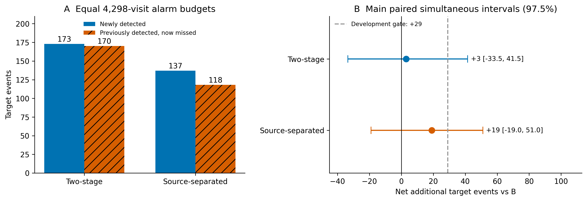
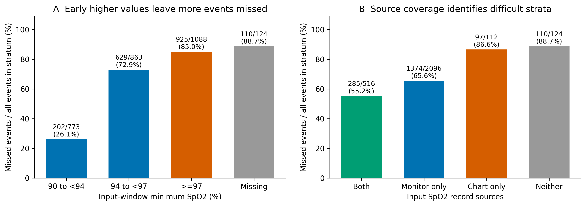
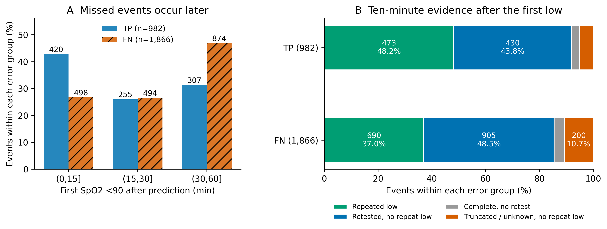
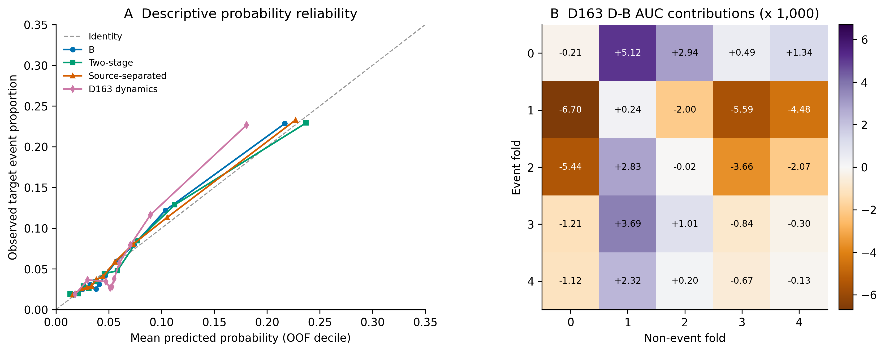

# MC-MED 低氧机制诊断与同预算改进结果（D164）

2026-11-08。两项候选均未通过预先批准的开发门槛，建议继续保留 B。相同 4,298 个报警名额下，两步概率乘积净增 3 例，来源分层净增 19 例；两项 97.5% 同时区间均跨零，也均未达到净增 29 例。按研究者D165复核意见，收尾当前同输入算法线；来源分层仅归档代码，不带入后续独立验证候选。

漏检主要集中在预测前 SpO₂ 较高、缺少输入期监护以及较晚出现首低的事件。漏检组重复低值较少，但绝大多数已有复测，且仍漏掉 690 个有十分钟内重复低值记录的事件；“没有复测”和“标签无法对齐”均不能解释大部分漏检。D165事后计数进一步显示，统一输入最低血氧构成后，完整观察且确有复测者的再次低值差从−10.41缩到−3.37个百分点；≥97层全审核窗仅一个低值分钟的有624/1088（57.4%）。缓存能定位深跌后下一分钟正常等模式，仍缺乏独立质量与处置证据来判临床真假。新增结果详见[D165事后描述](MC-MED_输入血氧与低值核验_D165_事后结果.md)。本稿为D165复核后的修订版，原D164所有模型成绩和锁定门槛保持原值。

## 1　固定 4,298 个名额，来源分层净增 19 例

共同队列为 42,983 次就诊、30,234 名患者；复合阳性 5,319 次，冻结 SpO₂ 归类 2,848 次，HR 1,857 次，MAP 614 次。保留原 MRN 五折和每次就诊；输入为安置床位后 [0,15] min，审核为 (15,75] min。按全体 OOF 分数稳定排序，同分沿原行序。

| 臂 | AUROC | AP | 检出／敏感度 | 新检出 | 丢失 | 净增［97.5% 同时区间］ |
| --- | --- | --- | --- | --- | --- | --- |
| 固定 B | 0.7416 | 0.2046 | 982 / 2,848 (34.5%) | 0 | 0 | 参照 |
| 候选一：两步概率乘积 | 0.7488 | 0.2133 | 985 / 2,848 (34.6%) | 173 | 170 | +3 [-33.5, +41.5] |
| 候选二：来源分层 | 0.7411 | 0.2127 | 1001 / 2,848 (35.1%) | 137 | 118 | +19 [-19.0, +51.0] |


两候选相对 B 的点估计均提高 AP，但在预算边界处收益很小。两步模型交换 1,135 个报警名额，来源分层交换 927 个；新旧报警集合的对称不一致比例分别为 5.28% 和 4.31%。这些变化同时带来新捕获和旧事件丢失。

| 比较 B | ΔAUROC［95%］ | ΔAP［95%］ | Brier | O/E | 每千次就诊净增事件 |
| --- | --- | --- | --- | --- | --- |
| 候选一：两步概率乘积 | +0.00718 [+0.00209, +0.01216] | +0.00879 [+0.00154, +0.01544] | 0.05719 | 1.005 | +0.070 |
| 候选二：来源分层 | -0.00057 [-0.00564, +0.00467] | +0.00816 [+0.00089, +0.01603] | 0.05721 | 1.023 | +0.442 |


B 的 Brier=0.05750，O/E=1.016。主门槛为 seed 2026 净增 ≥29、两项比较各自双侧 97.5% 区间下限 >0、AP 点估计不下降。两项均在净增幅度和区间两项失败。95% 区间用于描述，不能替换主要同时区间。

| seed | 配方 | AUROC | AP | 全体检出 | 相对同 seed B 净增 |
| --- | --- | --- | --- | --- | --- |
| 2026 | B | 0.74163 | 0.20455 | 982 | +0 |
| 2026 | 两步乘积 | 0.74882 | 0.21334 | 985 | +3 |
| 2026 | 来源分层 | 0.74106 | 0.21271 | 1001 | +19 |
| 2027 | B | 0.74318 | 0.20982 | 997 | +0 |
| 2027 | 两步乘积 | 0.74376 | 0.21300 | 974 | -23 |
| 2027 | 来源分层 | 0.74027 | 0.21083 | 1001 | +4 |
| 2028 | B | 0.73518 | 0.19791 | 964 | +0 |
| 2028 | 两步乘积 | 0.74512 | 0.21645 | 992 | +28 |
| 2028 | 来源分层 | 0.75024 | 0.21515 | 1011 | +47 |

两步AP在三个种子均提高，净检出方向仍不一致；来源相对同seed B均为正。2028的来源+47对应B2028，若对原固定B则为+29，实际配对区间未算，不能平移2026区间宣告过门槛。两步／来源三种子净增的样本标准差约25.5／21.8例，仅描述这三个拟合。原bootstrap条件于固定OOF分数，不含训练变化。



图 1。左侧为相同报警名额下的新捕获与丢失；右侧为患者聚类配对 bootstrap 1,000 次、seed 2026 的各 97.5% 同时区间。虚线为研究者批准的净增 29 例开发门槛。

## 2　高血氧输入、无监护和较晚首低是主要漏检位置

B 的 TP/FN/FP/TN 为 982／1,866／3,316／36,819。输入min<90层为0次就诊，D165核对原输入缓存的<90记录数也为0；这批冻结风险集评价的是前15分钟尚无低值、之后新出现<90记录的事件。仅按已知输入最低SpO₂从低到高、同分沿原行序、缺失排后，前4,298名检出798例；B多出184例。单变量参照属于事后诊断。输入最低 SpO₂ ≥97% 的事件有 1,088 次，漏掉 925 次，占全部漏检的 49.6%；这类事件的漏检率为 85.0%。输入期血氧完全缺失时漏检率为 88.7%，有监护时仍漏掉 1,659 个事件，说明缺监护只解释了一个小而困难的人群。

| 条件 | 就诊数 | 事件数 | 检出 | 漏检 | 事件漏检率 |
| --- | --- | --- | --- | --- | --- |
| 输入 min <90 | 0 | 0 | 0 | 0 | 空层 |
| 输入 min 90–<94 | 4019 | 773 | 571 | 202 | 26.1% |
| 输入 min 94–<97 | 12899 | 863 | 234 | 629 | 72.9% |
| 输入 min ≥97 | 24570 | 1088 | 163 | 925 | 85.0% |
| 输入 SpO₂ 缺失 | 1495 | 124 | 14 | 110 | 88.7% |
| 输入有监护 | 38914 | 2612 | 953 | 1659 | 63.5% |
| 输入无监护 | 4069 | 236 | 29 | 207 | 87.7% |
| 输入实测分钟 <4 | 7779 | 566 | 168 | 398 | 70.3% |
| 年龄 ≥75 | 10054 | 847 | 377 | 470 | 55.5% |
| 年龄 <75 | 32929 | 2001 | 605 | 1396 | 69.8% |


FN 的输入 SpO₂ 最低值中位数为 97.0%，TP 为 93.21%；末值中位数为 98.22% 和 95.67%。在有 SpO₂ 输入者中，min≥97% 占 FN 925/1,756、TP 163/968，比例差 +35.84 个百分点（95% CI +32.43～+39.19）。无监护占 FN 207/1,866、TP 29/982，差 +8.14 个百分点（+6.42～+9.92）。FN 年龄中位数为 60 岁，TP 为 69 岁；本轮低氧直接监督任务中 ≥75 岁检出率 44.5%，<75 岁 30.2%，没有出现老年组更难检出的描述性现象。

首低距预测点的中位数为 FN 29 min、TP 19.5 min。预测后 >30–60 min 首低占 FN 874/1,866（46.8%）、TP 307/982（31.3%），差 +15.58 个百分点（95% CI +11.64～+19.19）。这支持“漏检更多发生在离预测点较远的记录事件”，尚不能把时间先后解释为疾病演变或治疗的因果机制。



图 2。柱上给出每层漏检数／冻结事件数；全部使用同一全体报警政策，未在子组另选阈值。柱为原始描述比例，患者聚类比较见正文和聚合 JSON。

## 3　低值全部可对齐，但重复佐证的缺口不能归于普遍未复测

2,848/2,848 个冻结低氧事件均在原始审核窗找到 <90% 记录，超过预定 95% 工程核验线。首低来自 Monitor 2,798 次、Chart 50 次。所有就诊的离院字段均可解析；29 次所记离院早于预测点，另有 5 次就诊出现离院后的读数，后者的独立观察终点记未知。5 次中只有 1 个冻结低氧事件；不改变标签或模型输入。

补上原已计算的审核窗最低值：TP中位85.91（四分位81.04–88.55），FN中位86.27（81.51–88.69）。首低<70共103例，其中零值8例；全窗最低<70共186例，同含这8例零值。首低深度与全窗最低值分布、深跌后的下一记录计数见D165，均未用于改标签。

| 首低后十分钟状态 | TP（982） | FN（1,866） | 全部事件（2,848） |
| --- | --- | --- | --- |
| 不同分钟再次 <90 | 473 | 690 | 1163 |
| 完整十分钟且复测，未再次低值 | 430 | 905 | 1335 |
| 完整十分钟但无复测 | 30 | 71 | 101 |
| 截短／终点未知，未见再次低值 | 49 | 200 | 249 |


再次低值允许在右端截短前已经观察到；其余三类互斥。截短且有正常复测、无再次低值的事件为 TP 36、FN 162，已包含在最后一行。首低后十分钟内有复测者为 TP 939/982、FN 1,757/1,866；差 −1.46 个百分点（95% CI −3.14～+0.16）。完整观察机会为 TP 899、FN 1,582；完整机会且有复测为 TP 869、FN 1,511。

| 比较 | FN | TP | FN−TP 百分点［95%］ |
| --- | --- | --- | --- |
| 全体事件的再次低值 | 690/1866 (37.0%) | 473/982 (48.2%) | -11.19 [-15.15, -7.35] |
| 有完整观察机会的再次低值 | 606/1582 (38.3%) | 439/899 (48.8%) | -10.53 [-14.63, -6.41] |
| 完整机会且实测复测的再次低值 | 606/1511 (40.1%) | 439/869 (50.5%) | -10.41 [-14.49, -6.22] |


按延迟三层 × 输入监护有无 × 完整十分钟机会标准化后，再次低值比例差为 −9.75 个百分点（95% CI −14.08～−5.63），复测比例差为 +0.18 个百分点（−1.76～+2.05）。共同支持覆盖 FN 1,865/1,866、TP 982/982；1 个 FN 格无 TP，被明确排除。1,000 次聚类重抽中 52 次因稀少格一组为空无法估计，标准化区间使用其余 948 次；主候选与完整机会比较均为完整 1,000 次。这948次区间条件于支持格未变空，不能当作完整1000次无条件区间。

D165补入输入最低血氧层后，全体事件按输入层标准化的差从−11.19缩到−4.33个百分点；完整机会且有复测者从−10.41缩到−3.37，均覆盖全部相应事件。再加原三类条件时为−4.87／−4.19，但共同支持排除了FN67／TP5，人群不同。≥97层完整复测者差仅−0.60个百分点；按输入层统一后，≥75岁仍为−11.29、<75岁为−0.56。新结果仅为计数和描述差，无新置信区间。

5、10、15 min 复测窗口下，在“完整机会且实测复测者”中的 FN−TP 再次低值差分别为 −7.71、−10.41、−10.56 个百分点，95% 区间均在零以下。10 min 分年龄，≥75 岁为 129/371 对 171/326，差 −17.68 个百分点（−24.65～−10.57）；<75 岁为 477/1,140 对 268/543，差 −7.51（−13.08～−2.20）。无输入监护层 TP 仅 19 人，区间很宽，不能从该小格判断差异。

这些结果支持“漏检更常对应没有观察到再次低值的事件”。最强反证是仍漏掉了 690 个已观察到重复低值的事件，其中 606 个有完整观察机会。单次低值、复测恢复、同设备重复低值分别都不能裁定伪差或真实持续低氧。首低后是否给氧、设备信号质量及独立测量未进入本轮核验。事后发现未来有 8 条零值记录、涉及 8 次冻结事件（FN 6、TP 2），已单列计数，未删除或重新标记。



图 3。延迟均从预测点计时；核验状态按连续时间判定、不同实际分钟计重复，保留同分钟多源原记录。

## 4　来源记录和训练目标都解释了部分排序，但没有带来可靠净增

Monitor 与 Chart 同时出现于 6,218 次就诊（516 个事件），仅 Monitor 32,696 次（2,096 个事件），仅 Chart 2,574 次（112 个事件），两者均无 1,495 次（124 个事件）。Chart 是记录来源标签，不能由此证明独立人工测量或设备类型。两来源末值差的中位数为 0；绝对差 ≥3 个百分点 419 次、≥5 个百分点 111 次。来源可区分，较大冲突所占比例有限。同分钟双来源在输入期有849个就诊分钟／663次就诊，差≥3个百分点仅35格，跨越90阈值为0；审核期有469格／276次就诊，4格发生阈值两侧冲突，涉及4个FN，难以解释总体漏检。

来源候选净增 19 例，过程消融净增 14 例；来源数值相对过程消融仅净增 5 例（95% CI −31～+37），ΔAP +0.00223（−0.00560～+0.01043）。两来源均有记录时只净增 2/516 个事件（95% CI −11～+16），组内 AUROC 0.7472→0.7447；仅 Monitor 时净增 22 例（−7～+47），仅 Chart 时净减少 4 例（−9～−1，描述性、未校正子组多重比较）。当前数据未支持“来源特异生理数值”有独立稳定贡献。D165又核对了仅Monitor的32,696次就诊：来源monitor的min、last、分钟数、末测时刻均与B对应量完全相同，该组没有新增可用患者测量信息；该组+22不能归因于新的来源生理测量。

仅过程 LR 的 AUROC 0.6489、同预算检出 697；去掉 96 个显式过程字段后保留 248 列，检出 973，较 B 少 9。过程信息含风险，但这些消融不足以把生理信息与测量流程完全分开，因为缺失和可用值仍反映测量过程。

两步模型的复合事件头单独检出 737，乘入触发成分头后检出 985。它对原复合阴性的 AUROC 从 0.7463 到 0.7538（Δ+0.00749，95% CI +0.00228～+0.01248），对 HR 从 0.6853 到 0.6929（Δ+0.00757，−0.00107～+0.01566），对 MAP 从 0.6251 到 0.6122（Δ−0.01298，−0.02429～−0.00102）。因此主要排序收益来自与普通阴性的区分，没有证据表明它更全面地区分低氧和其他触发。固定阴性合并构成为共同权重后，B 的 ≥75／<75 AUROC 为 0.7492／0.7335，差 +0.01570（95% CI −0.00416～+0.03910，R3 探索性）。

原 3,316 个“低氧误报”中，HR 219、MAP 115、复合阴性 2,982。HR／MAP 误报中 55/334（16.5%）在原始记录里也有低值，HR／MAP 未报警中另有 120/2,137（5.6%）；冻结归类仍不改。复合阴性未发现原始未来低值。误报有未来 SpO₂ 读数的比例为 HR 218/219、MAP 114/115、复合阴性 2,881/2,982，不支持主要误报源于完全没有未来测量。

| 条件 | 目标事件分母 | B 检出 | 两步模型净增［95%］ | 来源分层净增［95%］ |
| --- | --- | --- | --- | --- |
| ≥75 岁 | 847 | 377 | +8 [-15.0, +29.0] | -6 [-26.0, +11.0] |
| 无输入监护 | 236 | 29 | +16 [+4.0, +27.0] | -5 [-14.0, +4.0] |
| 输入 min≥97 | 1088 | 163 | -7 [-25.0, +12.0] | +5 [-8.0, +22.0] |
| 十分钟内再次低值 | 1163 | 473 | +17 [-8.0, +42.0] | +17 [-7.0, +34.0] |
| 完整机会且再次低值 | 1045 | 439 | +19 [-5.0, +43.0] | +20 [-2.0, +37.0] |


子组均沿用全体政策。来源候选在重复低值事件中净增 17、完整机会重复低值中净增 20，区间仍跨零；≥75 岁净减少 6 例。不能据全体 +19 推定所有重点人群受益。

## 5　跨折刻度会改变名额分配，通用维度惩罚未获支持

D163 动态 D−B 的全体 ΔAUROC=−0.014270。25 格贡献严格加回直接差；同折配对权重 0.200047、跨折 0.799953，同折贡献 −0.000963、跨折 −0.013307。除以各自权重后，条件差为 −0.004813 与 −0.016635。跨折约占净下降 93.3%，且权重归一化后下降仍更大，支持继续把折间排序当作解释之一。

| 臂 | 全体 4,298 名额检出 | 各折 floor 后总名额 | 各折 floor 检出 | 余数分配至 4,298 后检出 |
| --- | --- | --- | --- | --- |
| 固定 B | 982 | 4296 | 981 | 981 |
| D163 动态 D | 974 | 4296 | 1014 | 1014 |
| 候选一：两步概率乘积 | 985 | 4296 | 986 | 986 |
| 候选二：来源分层 | 1001 | 4296 | 999 | 999 |
| 仅来源次数／时距 | 996 | 4296 | 1019 | 1019 |
| R6 占位特征 | 1005 | 4296 | 1003 | 1003 |
| B seed2027 | 997 | 4296 | 1019 | 1020 |
| B seed2028 | 964 | 4296 | 990 | 990 |
| D163 P | 998 | 4296 | 995 | 996 |


B 的全体折间名额分配为 1,055／713／903／926／701；D 为 706／1,269／1,205／562／556。各折总量按最大余数法统一到 4,298 后，D 比 B 多 33 例，全体合并政策下则少 8 例。这个反向结果证明合并策略对预算结果有实质影响；同时 D 的同折 AUROC 条件差仍为负，因此刻度不能解释全部排序下降。

在各外折训练人群的 inner 分数上预置第 90 百分位阈值、应用到外折时，B 报警 4,232／检出 974；D 4,187／989；两步 4,225／975；来源 4,305／1,004。这些名额不等，是部署敏感性描述，不能拿检出差替代主同预算比较。来源候选各折自然报警率约 9.66%～10.67%。

R6 中 D 的 23 列有 4 列可由 B 的 last−min 精确重构。前20列的缺失均可由相应通道实测分钟数重构，后三列由共同相邻分钟可观测性重构；23列分别在42,983行全部匹配，表明缺失模式本身也带有既有过程信息。B 最优轮次为 179／22／110／54／24，D 为 11／123／117／9／9，占位为 80／80／69／49／92。按通道可观测模式、从训练折无标签抽样、保留相同缺失位置的占位臂检出 1,005、净增 23（95% CI −10～+53），并未出现类似退化。因此本次对照不支持“增加相同列数和缺失模式就会退化”。早停与择分裂对具体列的敏感性有迹象，尚不能唯一归因某个参数；占位不列入候选升级。固定 B＋LR 的等权 logit 平均 AUROC 0.7480、AP 0.2090，仍检出 982。



图 4。左图为固定 OOF 分数十分位描述性可靠性图；右图每格为事件折与非事件折对 ΔAUROC 的贡献，单位 0.001。未对外折结局拟合校准器。

## 6　证据支持的解释和仍不能区分的原因

| 解释 | 本轮判断与证据 | 最强反证／未能区分 | 行动含义 |
| --- | --- | --- | --- |
| 离预测点远 | 支持关联：FN 首低中位 29 对 19.5 min；>30 min 差 +15.58 pp | 早于15 min 首低仍漏498例；晚发本身非病因 | 下一次核对预测前用氧、既往基线和急性偏离，保留同一任务 |
| 缺少再次低值佐证 | 支持记录差异：完整机会且复测仍差−10.41 pp；标准化仍差−9.75 pp | 690个FN已有重复低值；正常复测也可能对应恢复或处置 | 采集独立质量与处置时点；不以“孤立”改标签 |
| 没有后续复测导致漏检 | 不足以解释多数：FN 94.2%有复测，标准化复测差接近0 | 完整机会无复测71个、截短无重复200个仍待核验 | 针对271个FN的记录机会补全，可解释范围有限 |
| 来源特异数值 | 未获稳定增量：完整候选对过程消融+5，CI−31～37；双方有记录仅+2 | 来源仅Chart的小格更难；6,218次双来源中只有419次末值差≥3 pp | 保存来源字段，不继续在当前开发集遍历来源特征 |
| 训练目标混合其他事件 | 两步改善部分排序，AP提升；同预算只+3 | 对MAP条件AUROC反向，三种子净增方向不一 | 停止本轮两步配方扩展 |
| 折间刻度／算法早停 | 支持部分影响：D按同折预算相对B+33、合并−8；早停差大 | D同折AUROC也下降；占位没有类似退化 | 保留分解和训练内阈值诊断，独立数据中核对 |
| 真实持续低氧、伪差或处置后恢复 | 可定位单次深跌后下一分钟正常等模式，尚不能判临床真假 | 同来源不同分钟重复不等于独立测量，未来处置未核验 | 前瞻增加设备质量、用氧状态及独立复测，不扩大算法遍历 |


R4 的记录核验界：已观察到再次低值 1,163 例；完整机会无复测／截短未重复共 350 例。若这 350 例全部补出再次低值，可达 1,513 例。FN 对应为 690～961，TP 为 473～552。这是缺失记录机会补全下的核验范围，保留完整窗口已复测无重复者的记录分类；它不构成真实低氧人数的上下界。

## 7　同输入算法线收尾，先澄清医院低氧记录终点

R1 的折内／全体预算与训练内阈值、R2 的 5／10／15 min 核验、R3 的 HR／MAP 与阴性构成、R4 的核验界和独立合成复算、R5 的医院采集表和精度情景、R6 的占位对照均已完成。主流程提前完成后继续执行了这些任务，没有用等待凑满 12 小时。

研究者已决定收尾当前同输入算法线，保留B，来源仅归档代码。来源的同时区间上界+51对应敏感度约36.3%，尚无法排除小增益，但结合无新增患者信息扰动的相近幅度、过程消融、缺少来源生理增量，以及医院几十个事件的分辨率，没有继续安排独立候选验证。D165中≥97层624/1088仅一个低值分钟，完整十分钟且实测复测者中仍有472/884全窗单次；其中首低<70且下一不同分钟≤1min已≥90的有17例。当前证据优先要求厘清医院目标是任一低值、重复低值还是伴随处置的低氧，再按可观察分母决定用氧、可靠既往基线和质量采集。单次记录不能直接判成伪差，医院终点保持待研究者另定。

医院采集的一页字段表与 GAM/GD 共同可观察分母壳见 [D164 前瞻采集与配对精度](MC-MED_前瞻采集与配对精度_D164.md)。当前来源候选的事件报警不一致比例为 8.95%，两步为 12.04%；以 2,848 个事件、假设 q=0.10、患者设计效应1示例，97.5% 配对敏感度差区间的近似半宽为 1.33 个百分点。把半宽压到 1 个百分点需约 5,024 个可分析事件；设计效应1.5时约 7,536 个。它们是精度情景，不等于80%检出把握：若真实差为1个百分点、q=0.10、每项双侧α=0.025，正态近似需约9,503事件达到80%把握，DEFF1.5约14,255。实际共享预算和患者聚类需模拟；没有用本轮点估计算事后功效。本轮区间约35–38例的半宽使“下限>0”比29例幅度条件更严格，门槛阴性不应被解释为已精确排除29例真效应。

## 8　其他路线的原有问题仍按各自分母解释

下表只引用已有聚合报告，没有重开封存确认集或医院病例。MC-MED 本轮结果不能替代这些不同终点和人群的验证。

| 原问题 | 原指标、分母与证据 | 本轮对应结论 |
| --- | --- | --- |
| MIMIC ESI 与年龄校准（D109 §4.2） | 确认集39,231次／2,092事件；ESI 3–5 O/E 0.36–0.47→0.93–1.05，ESI 1–2 1.16–1.27→0.98–1.00 | 已有背景字段能修刻度；本轮可靠性诊断不重新评价该确认集 |
| MIMIC 稀疏高危及高龄（D139–142） | 开发OOF ≤1×ESI1–2差距 LGBM −0.173→−0.098；≥75非事件收住院58%对30%，剔除标签外重症仅缩小0.008–0.010 | 保留预测前背景与处置信息的采集方向；D161 已收尾的到院2h路线不重开 |
| MC-MED 低密度和序列模型（D109、D140） | 确认集观测≤15：853次／106事件，发现差−0.069～−0.084，确认差−0.009～−0.030，全部区间跨0；放宽Raindrop训练后子组差距变化≤0.006 | 本轮无输入监护是小而困难层，不能把旧低密度发现直接当已确认机制 |
| 小样本迁移与两院共同终点（D156、J线） | D156确认 MC-MED 2,602／312、MIMIC39,231／2,092，小样本等权集成6/6比较优于；J线GD271／61与GAM115／31生理事件中主要触发分别P/F84%、RR93% | 本轮B＋LR同预算净增0；不把小样本复合终点优势或院间不同定义移植为低氧结论 |


来源：既有 `ed_ts_bench_确认集结果_D109_20261104.md` §3、§4.2；`ed_ts_bench_补丁3后续_局限处理_结果_20261107.md` §1–5；`小样本配方确认_结果_20261108.md` §1–3；`J线_最终报告_20261105.md`“证据”。

## 9　复现、验证与交接

实际模块均在 `W/basemodel/experiments/ed_ts_bench/d164/`。`prepare` 只通过授权的 train 列投影读取区外标签一次，之后全部复用私有缓存。`audit` 的未来表与输入表分离；`fit` 不读取未来表；`evaluate` 只在评价阶段连接审核字段。删除未来记录或把全部未来值替换后，B／来源矩阵逐值相同，保存模型在五外折的 B、复合头、成分头、来源候选共40次预测哈希相同，乘积由相同两头确定。

B 和 D 重建概率最大绝对差均为0，报警成员改变0。患者训练／inner／外折集合均断言隔离，每次就诊各臂恰好1个OOF分数。独立显式复制重复就诊、sklearn AUROC/AP 和稳定预算复算的最大差为 1.11×10⁻¹⁶。原3b训练集级预处理为继承的参照限制，新估计和填补均局限于本折训练人群；LightGBM原生保留缺失，LR沿用原折内中位数、缺失指示和标准化。

准备阶段明确排除176条空 Value 输入记录（44就诊／44患者），与D163一致；未来空值211条，不作为实测。输入及未来SpO₂无超出0–100的有限值，未按临床真假删除记录。LPM_O2输入覆盖922次就诊（2.15%）；源schema没有单位列，本轮只报告字段名和覆盖，没有把缺失当作未吸氧。

| 阶段 | 退出码／状态 | 耗时或锁定证据（logs/2026-11-08/d164/） |
| --- | --- | --- |
| 设计锁定 | 通过 | design_lock.txt |
| prepare | 0 | 77.9 s；prepare_v1_lock.txt |
| audit／R2初步／R3 | 0 | 28.1 s；audit_v1_lock.txt |
| fit seed2026 | 0 | 108.8 s；fit_evaluate_v1_lock.txt |
| 队列v1续跑驱动 | 1 | seed2026完成后 zsh 不支持 PIPESTATUS test；尚未开始2027/2028 |
| 显式bash续跑2027／2028 | 0 | 46.1／47.7 s；driver_v2_lock.txt，已完成2026按哈希复用 |
| evaluate | 0 | 75.1 s；evaluation_v1_inputs_lock.txt |
| 补充R1–R4 | 0 | 31.3 s；supplement_v1_lock.txt |
| R5／图表 | 0 | R5_v1_lock.txt；plots.py |
| 合成验证 | 0 | 主拟合前9项；共13项通过（先11项、再补2项），35条依赖弃用／特征名警告 |
| 最终哈希／权限 | 0 | 117项匹配；128个私有文件均600，目录700 |


补充 AUC 的独立合成复核在首次补充聚合计算后完成；结果与 sklearn 显式展开一致，主候选在真实计算前已完成9项合成验证。prepare后、audit前只调整了未来审核 helper 的首低取行与离院早于t0时的观察长度处理，并在audit锁定；原helper和原7项测试的精确字节版本已归档，原锁定哈希可核对。所有失败与原版本保留，无删除。

执行入口（在服务器 `W/basemodel/`；原输出存在时 prepare／fit／evaluate 会拒绝覆盖，重新完整实验须登记新版本目录）：

```bash
.venv/bin/python -m pytest tests/test_d164.py tests/test_d164_reserve.py tests/test_d164_completeness.py -q -p no:cacheprovider
.venv/bin/python -m experiments.ed_ts_bench.d164.prepare
.venv/bin/python -m experiments.ed_ts_bench.d164.audit
.venv/bin/python -m experiments.ed_ts_bench.d164.fit --seed 2026
.venv/bin/python -m experiments.ed_ts_bench.d164.fit --seed 2027
.venv/bin/python -m experiments.ed_ts_bench.d164.fit --seed 2028
.venv/bin/python -m experiments.ed_ts_bench.d164.evaluate
.venv/bin/python -m experiments.ed_ts_bench.d164.supplement
.venv/bin/python -m experiments.ed_ts_bench.d164.reserve_r5
.venv/bin/python -m experiments.ed_ts_bench.d164.completeness
.venv/bin/python -m experiments.ed_ts_bench.d164.plots
.venv/bin/python -m experiments.ed_ts_bench.d164.validate
.venv/bin/python -m experiments.ed_ts_bench.d164.report
```

主要数值来源为同目录 `prepare.json`、`audit.json`、`evaluation.json`、`supplement.json`、`completeness.json`、`R5_precision.json`、`fit_seed2026.json`、`verification.json`；完整输入行序指纹与各阶段 SHA256 留在日志中。行序 SHA256：`2a6786bec33b30099cc940b2d8f37c4caf979d2ff294593d7dcd407c6c8e077e`。仅这些聚合量、代码和图表同步本机；缓存、模型、患者键与逐例预测均保留服务器。

依赖：numpy=2.2.6, pandas=2.3.1, pyarrow=24.0.0, scikit-learn=1.7.2, scipy=1.15.3, lightgbm=4.6.0, joblib=1.5.3。

本轮80次正式树拟合与5次过程LR拟合全部完成。未完成的研究证据为独立时期／机构验证、独立测量的临床真假审核、未来处置与信号质量核验；这些未被本轮数据替代。临床模型或终点的新决定另行由研究者锁定。

## 10　D165事后修订与版本保留

此次修订补齐输入<90空层、单变量798例参照、每种子AUROC/AP、P和换种子的折名额、审核窗最低值，并将来源候选改为代码归档。D165事后计数及运行记录见[新描述报告](MC-MED_输入血氧与低值核验_D165_事后结果.md)。所有新解释均标事后，没有改变D164检验。

D164原版快照为[修订前报告](MC-MED_低氧机制诊断与候选检验_D164_结果_D165前.md)，其SHA256仍对应原d164_reproducibility.json；当前修订文档的哈希和历史文件映射另记在d165_reproducibility.json。原d164.report入口重建原实验报告，新事后报告由d165_report生成。
