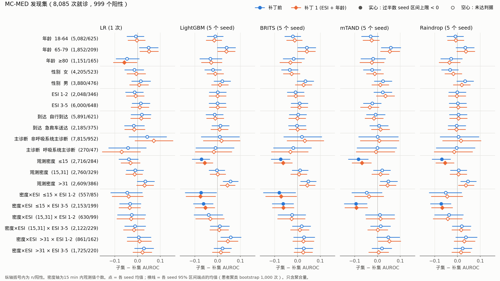
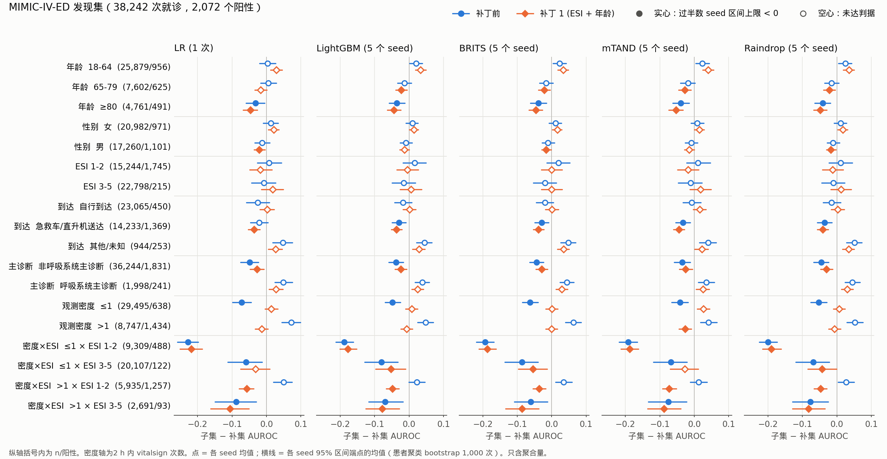

# MC-MED 与 MIMIC-IV-ED 时序模型子集诊断：本周周报（11-02 至 11-08）

只含聚合量。

- **状态：** 11-04 晚。发现集上的工作已经做完。研究者 11-04 放行补丁 1（"确认补丁 1"），确认集（D109）已评价一次，结果见 §5 和 `ed_ts_bench_确认集结果_D109_20261104.md`。§0、§4 已按确认集结果改写。
  - 11-05：补丁 3（加输入）方案已锁定（D113），输入已建好，84 个 run 在服务器上运行，跑完后只在发现集上评价（D111），结果补进本文。
- **计划：** `plans/急诊监督模型/MC-MED与MIMIC-IV-ED_时序模型子集诊断_本周计划_20261102-1108.md`（服务器 `docs/basemodel/plan/week06/`）
- **决定：** D103–D113（计划 §8；服务器 `docs/basemodel/plan/week02/研究者决策记录_20261005.md`）
- **本周报告：**
  - `MC-MED与MIMIC-IV-ED_只出计数核查_20261103.md`
  - `ed_ts_bench_子集发现结果_20261103.md`（第二版）
  - `ed_ts_bench_补丁1_发现集结果_20261104.md`
  - `ed_ts_bench_补丁2_发现集结果_20261104.md`
  - `ed_ts_bench_确认集结果_D109_20261104.md`
  - `research/数据集资源/ts-datasets-survey-20261103/`、`research/数据集资源/ed-datasets-20261103/`

  本文的数字都出自这几份报告和服务器 `logs/2026-11-03/`、`logs/2026-11-04/` 的聚合表；森林图由 `W/tmp/weekly_forest.py` 只读这些聚合表画出。
- **发现集：** MC-MED = 验证集 + 测试集 A 半，8,085 次就诊、999 个阳性；MIMIC-IV-ED = 验证集，38,242 次就诊、2,072 个阳性。每个 run 在自己的验证集预测上做 Platt 再校准（D106）。

## 0 一页结论

1. **会上的五步，前四步在发现集上已经走完，补丁 1 已在确认集上检验一次；第五步的备用数据集也已检索。** 见 §1。缺 FF-LSTM、GRU-D，等梁睿颖。
2. **没有"只有时序模型差"的子集。** 两库凡是稳定变差的子集，LightGBM 和三个时序模型都一起差（§3、§4）。模型之间的差距在各子集上基本是整体差距的平移。"给时序模型结构打补丁"目前没有子集目标。
3. **两库共同的短板是观测少的就诊。**
   - MC-MED：15 分钟内 ≤15 个值，约占三分之一；
   - MIMIC-IV-ED：2 小时内 vitalsign ≤1 次，占 77%。
4. **补丁 1（加 ESI 和年龄作为输入，D108）在 MIMIC-IV-ED 上效果大，并在确认集上得到确认；在 MC-MED 上效果小，没有得到确认。**
   - MIMIC-IV-ED：
     - 发现集上五个模型总体 AUROC 升 0.025–0.047；确认集上升 0.023–0.042，五个模型都判为"提升"，全部 seed 成立。
     - 按 ESI、年龄的校准偏差基本消除，确认集上同样如此。
     - "vitalsign ≤1 次"在发现集上不再稳定变差。确认集上差距缩小了一半以上（−0.071 到 −0.100 → −0.010 到 −0.036），但五个模型仍稳定变差。
   - MC-MED：
     - 发现集上只升 0.004–0.009，部分 seed 成立；确认集上 −0.001 到 +0.009，五个模型都是"无明确差别"。
     - ≤15 个值的三个子集在发现集上补丁后仍然变差。
5. **补丁 2（训练时随机删观测，D110）没有作用。** 与补丁 1 相比：
   - 两库总体 AUROC 差 −0.002 到 +0.003；
   - 预先登记的低密度格子，组内 AUROC 差 −0.009 到 +0.005。

   这说明低密度子集差，更可能是因为窗口里信息本来就少，而不是训练时见到的稀疏样本不够。
6. **发现的缺陷在确认集上的复现情况（D109 确认 A）：44 对里复现 29 对，全在 MIMIC-IV-ED。**
   - MIMIC-IV-ED 复现：≥80 岁、急救车/直升机送达、≤1 次、≤1 × ESI 1–2、≤1 × ESI 3–5、>1 × ESI 3–5。
   - 未复现："非呼吸系统主诊断"5 对，以及 MC-MED ≤15 个值的三格 10 对。
     - MC-MED 这 10 对的方向相同，但幅度大多不到发现集的一半。
     - MC-MED 确认集只有 312 个阳性，"未复现"不等于"不存在"。
7. **补丁 1 之后，确认集上仍是所有模型都差的子集（MIMIC-IV-ED）：**
   - ≥80 岁、急救车/直升机送达、≤1 次、≤1 × ESI 1–2、≤1 × ESI 3–5、>1 × ESI 3–5；
   - 补丁后才冒出来的 65–79 岁；
   - 确认集上才出现的 ESI 3–5（未登记，只作描述）。

   要缩小这些差距，需要给模型更多信息：更长的窗口，或化验、主诉、到达方式、既往史等输入。这些都要改 D103/D107，属于 A 档（§4、§6）。
8. **确认集已经用掉，多重比较未校正。** 研究者已定：之后的补丁只在发现集上探索（D111，§6）。

## 1 本周交付对照（计划 §4）

| 交付 | 状态 | 位置 |
|---|---|---|
| 调研表：常用时序模型原文的数据集、序列长短、是否划子集 | 完成。12 个模型、2 个急诊基准，来源 S101–S116。这些模型都在 ICU 前 48 h、每例几十到几百个时点的序列上调出来；按年龄、病情、观测密度报告分组性能的几乎没有，只有 Raindrop 做了按年龄、性别跨组 | `research/数据集资源/ts-datasets-survey-20261103/` |
| MIMIC-IV-ED 时序任务建成并锁定；五个模型跑完 | 完成（D103）。387,249 次就诊，事件 20,722 个（5.35%）；LR 1 次，LightGBM、BRITS、mTAND、Raindrop 各 5 个 seed | 子集发现结果 §0；服务器 `derived/ed_ts_bench/` |
| 逐子集结果、表现差的子集清单（原因假设、补丁候选） | 完成，两库都有。补丁 1、2 已在发现集上做完 | 本文 §3、§4；三份结果报告 |
| 急诊数据集备选清单 | 完成，来源 S121–S128。带时间戳体征的公开急诊原始库只核实到 MIMIC-IV-ED 和 MC-MED 两个，都已在服务器上；衍生库（如 MIMIC-IV-Ext-MDS-ED）与 MIMIC-IV-ED 同源，不能当外部验证 | `research/数据集资源/ed-datasets-20261103/` |
| FF-LSTM、GRU-D（两库） | 未做，等梁睿颖。计划 §10 的消息还没发 | — |
| 确认集评价（D109） | 完成。研究者 11-04 放行补丁 1，两库各评价一次 | §5；`ed_ts_bench_确认集结果_D109_20261104.md` |

## 2 两库总表（发现集）

**任务：**

| | MC-MED | MIMIC-IV-ED |
|---|---|---|
| 任务 | `decomp_60`（沿用 `mp_benchmark_v1`） | D103：到院后 2 h 预测，此后 12 h 内进 ICU 或院内死亡 |
| 输入窗口 | 到床后 15 min，1 min 网格 16 步 | [到院, 2 h)，分诊值放在第 0 分钟 + vitalsign |
| 体征（D107） | HR、RR、SpO₂、SBP、DBP、MAP | HR、RR、SpO₂、SBP、DBP、体温 |
| 观测密度 | 训练集三分位切点为 15、31 个值 | vitalsign 时点中位 1 个；三分位切点都是 1 |
| 发现集 | 8,085 次 / 999 个阳性（12.4%） | 38,242 次 / 2,072 个阳性（5.4%） |

**总体 AUROC（5 个 seed 均值；LR 1 次）：**

| 模型 | MC-MED 补丁前 | 补丁 1 | 补丁 2 | MIMIC-IV-ED 补丁前 | 补丁 1 | 补丁 2 |
|---|---:|---:|---:|---:|---:|---:|
| LR | 0.705 | 0.709 | 0.707 | 0.846 | 0.893 | 0.893 |
| LightGBM | 0.734 | 0.740 | 0.739 | 0.877 | 0.905 | 0.905 |
| BRITS | 0.730 | 0.735 | 0.733 | 0.879 | 0.904 | 0.904 |
| mTAND | 0.690 | 0.700 | 0.702 | 0.862 | 0.892 | 0.894 |
| Raindrop | 0.708 | 0.713 | 0.712 | 0.874 | 0.903 | 0.903 |

同模型、同 seed 配对比较，区间按患者聚类 bootstrap 1,000 次：

- **补丁 1 减补丁前：**
  - MIMIC-IV-ED 五个模型都在全部 seed 上区间下限 > 0；
  - MC-MED 区间下限 > 0 的 seed：LightGBM 3/5、mTAND 4/5、BRITS 2/5、Raindrop 2/5，LR 那一次不成立。
- **补丁 2 减补丁 1：** 两库都没有稳定差别。MC-MED 的 LR 下降 0.002，但 LR 只有一次 run。

**总体 AUPRC，补丁前 → 补丁 1：**

| 模型 | MC-MED | MIMIC-IV-ED |
|---|---|---|
| LR | 0.274 → 0.278 | 0.407 → 0.458 |
| LightGBM | 0.326 → 0.333 | 0.473 → 0.506 |
| BRITS | 0.322 → 0.320 | 0.491 → 0.510 |
| mTAND | 0.281 → 0.293 | 0.423 → 0.450 |
| Raindrop | 0.276 → 0.283 | 0.457 → 0.486 |

模型排序补丁前后基本不变：两库都是 LightGBM 与 BRITS 领先，mTAND 在三个时序模型里最低。mTAND 两库、Raindrop 在 MC-MED 上整体低于 LightGBM，这不是某个子集的问题。

## 3 子集森林图（发现集；补丁前与补丁 1）

**读图方法：**
- 每一行是一个预先登记的子集（D104），括号内为就诊数/阳性数。横轴是子集减补集的 AUROC 差，小于 0 表示模型在这个子集上排序不如其余就诊。
- 蓝色圆点是补丁前，橙色菱形是补丁 1。点是各 seed 的均值；横线是各 seed 95% 区间端点的均值，不是合并后的区间。
- 实心表示过半数 seed 的区间上限 < 0，也就是发现阶段的"稳定变差"判据。LR 只有一次 run。
- 补丁 2 与补丁 1 几乎重合（§0 第 5 条），没有画。

**MC-MED：**
- 实心点只在"观测密度 ≤15"和它与 ESI 的两个交叉格。LightGBM 和三个时序模型都在，补丁前后都在。
- LR 在 ≥80 岁、补丁 1 后被标出，但只有一次 run，配对差区间跨 0。
- 其余维度（年龄、性别、ESI、到达方式、主诊断）没有稳定变差的子集。

**MIMIC-IV-ED：**
- 五个小图的实心点位置几乎一样，说明短板是所有模型共有的。
- 补丁 1 让"观测密度 ≤1"从实心变成空心，并且回到 0 附近。这一点在确认集上没有复现：补丁后差距缩小，但五个模型仍是实心（§5）。
- "≤1 × ESI 1–2"（约 −0.19 到 −0.23）和"≥80 岁"补丁前后都在。
- 补丁后新变成实心的有 65–79 岁、密度 >1 × ESI 1–2，以及部分模型的男性、急救车送达（LR）、密度 >1（mTAND）。这些是因为补集提高得更多，子集自身的组内 AUROC 基本没降（补丁 1 报告 §1 第 5 条）。

## 4 表现差的子集清单（补丁 1 之后仍是所有模型都差的）

"子集减补集"是相对量，按强预测因子切出来的子集组内 AUROC 会机械性地变低（子集发现结果 §4）。所以下表的"原因"都是**假设**，还没有检验。

| 库 | 子集（发现集 n / 阳性） | 子集减补集：补丁前 → 补丁 1（五个模型的范围） | 原因假设 | 补丁候选 | 验证办法 | 改口径？ |
|---|---|---|---|---|---|---|
| MC-MED | 观测 ≤15 个（2,716 / 284），及 × ESI 3–5、× ESI 1–2 | ≤15：−0.039 到 −0.084 → −0.031 到 −0.069；补丁 2 不变 | 15 min 窗口内信息太少；补丁 2 已基本排除"训练时稀疏样本不够" | ① 更长的窗口；② 加 MC-MED 已有的波形（ECG、PPG）派生特征 | 同一发现集、同 seed 配对：看 ≤15 格的组内 AUROC 与总体 AUROC | ①② 都要改任务或 D107（A 档） |
| MIMIC-IV-ED | ≥80 岁（4,761 / 491） | −0.032 到 −0.041 → −0.044 到 −0.053（组内升 0.018–0.034，补集升得更多） | 高龄患者恶化不太体现在体征上（不典型表现）；合并症不是输入 | 加既往史或合并症（MIMIC-IV hosp 中本次之前的住院诊断）作为静态输入 | 组内配对差 + 总体配对差；按年龄看观察/预期比 | 改 D107（A 档）；要先核对只取到院前的信息 |
| MIMIC-IV-ED | 急救车/直升机送达（14,233 / 1,369） | −0.021 到 −0.035 → −0.036 到 −0.044（补丁前 LR 未被标出） | 到达方式不是输入；这组病人更重、更杂 | 到达方式作为静态输入，做法同补丁 1 | 同上；三组到达方式的观察/预期比补丁 1 后仍偏 0.60–2.13 | 改 D107/D108（A 档） |
| MIMIC-IV-ED | ≤1 次 × ESI 1–2（9,309 / 488） | −0.188 到 −0.227 → −0.178 到 −0.218 | 只有分诊值，而 ESI 在格内是常数；组内限制效应很大 | 更长的窗口（4 h：vitalsign 中位 2 次，但要排除 31% 停留不足 4 h 的就诊）；加化验或主诉 | 组内配对差；4 h 方案要另算排除人数 | 改 D103 或 D107（A 档） |
| MIMIC-IV-ED | >1 次 × ESI 3–5（2,691 / 93） | −0.061 到 −0.088 → −0.078 到 −0.107 | 阳性只有 93 个，区间宽；ESI 3–5 中体征被多次测量的人本身可能更异质 | 同上 | 确认集里只有 87 个阳性（D109 方案 §4），把握有限 | — |
| MIMIC-IV-ED | 非呼吸系统主诊断（36,244 / 1,831） | −0.035 到 −0.049 → −0.025 到 −0.030 | 补集是呼吸系统主诊断（1,998 次），这些病人的低氧容易被 SpO₂ 抓到 | 不作补丁目标：主诊断是离院时才有的信息，只作回顾性分组 | — | — |
| MIMIC-IV-ED | 补丁 1 后新标出：65–79 岁、>1 次 × ESI 1–2 | 65–79：+0.006 到 −0.018 → −0.017 到 −0.027（LR 未被标出）；>1 × ESI 1–2：+0.013 到 +0.049 → −0.036 到 −0.073 | 补集提高更多造成的相对变化，组内 AUROC 基本不降（mTAND 在 >1 × ESI 1–2 上降 0.007） | 先不作补丁目标 | 确认集上描述性看一次 | — |

补丁 1 在发现集上解决、补丁后不再稳定变差的子集：
- MIMIC-IV-ED "vitalsign ≤1 次"：子集减补集由 −0.042 到 −0.072 变成 +0.001 到 +0.027。
- "≤1 次 × ESI 3–5"有部分改善，LR、mTAND 不再被标出。

两条在确认集上都没有复现：补丁后五个模型仍都被标出。差距确实缩小了：
- ≤1 次：−0.071 到 −0.100 → −0.010 到 −0.036；
- ≤1 × ESI 3–5：−0.098 到 −0.156 → −0.075 到 −0.116。

**确认集对上表的修正：**
- "非呼吸系统主诊断"没有复现。
- MC-MED 三格没有复现，但确认集只有 312 个阳性，把握有限。
- ">1 × ESI 3–5"（确认集 87 个阳性）复现，补丁后五个模型仍都被标出。
- 65–79 岁补丁后的变差在确认集上五个模型都出现。
- ">1 × ESI 1–2"在确认集上只剩 mTAND。

## 5 确认集（D109）

**已评价一次。**

- **放行：** 研究者 11-04 回复"确认补丁 1"，只放行补丁 1，补丁 2 不在内。
- **确认集：** MC-MED 测试集 B 半，2,602 次就诊、312 个阳性；MIMIC-IV-ED 测试集，39,231 次、2,092 个阳性。
- **校准：** 每个 run 用自己验证集上的 Platt。

细节见 `ed_ts_bench_确认集结果_D109_20261104.md`，聚合表在服务器 `logs/2026-11-04/ed_ts_bench_confirm_*`。

**确认 B：补丁 1 减补丁前，总体 AUROC**

同模型、同 seed 配对；判据为过半数 seed 的 95% 区间不跨 0；不做多重比较校正。

| 模型 | MC-MED 前 → 后 | 差 | 结论 | MIMIC-IV-ED 前 → 后 | 差 | 结论 |
|---|---|---|---|---|---|---|
| LR | 0.724 → 0.723 | −0.001 | 无明确差别 | 0.848 → 0.890 | +0.042 | **提升**（1/1） |
| LightGBM | 0.752 → 0.752 | +0.000 | 无明确差别 | 0.877 → 0.902 | +0.025 | **提升**（5/5） |
| BRITS | 0.744 → 0.746 | +0.002 | 无明确差别（1/5 升） | 0.877 → 0.900 | +0.023 | **提升**（5/5） |
| mTAND | 0.699 → 0.708 | +0.009 | 无明确差别 | 0.859 → 0.888 | +0.029 | **提升**（5/5） |
| Raindrop | 0.713 → 0.719 | +0.006 | 无明确差别 | 0.872 → 0.900 | +0.028 | **提升**（5/5） |

- **MIMIC-IV-ED：** 确认集上的提升与发现集（+0.025 到 +0.047）几乎相同，各 seed 区间下限最小 +0.011。
- **MC-MED：** 点估计与发现集（+0.004 到 +0.009）接近，但 312 个阳性区分不出这么小的差别。

**确认 A：发现集上的 44 对"子集 × 模型"缺陷（补丁前）**

| 库 | 子集 | 确认集 n（阳性） | 发现集差 → 确认集差 | 结论 |
|---|---|---|---|---|
| MC-MED | ≤15 个值 | 853（106） | −0.069 到 −0.084 → −0.009 到 −0.030 | 4 对未复现 |
| MC-MED | ≤15 × ESI 3–5 | 696（70） | −0.062 到 −0.095 → −0.024 到 −0.055 | 4 对未复现 |
| MC-MED | ≤15 × ESI 1–2 | 155（36） | −0.073、−0.080 → +0.000、−0.014 | 2 对未复现 |
| MIMIC-IV-ED | ≥80 岁 | 4,735（471） | −0.032 到 −0.041 → −0.049 到 −0.061 | 5 对复现 |
| MIMIC-IV-ED | 急救车/直升机送达 | 14,947（1,342） | −0.029 到 −0.035 → −0.028 到 −0.035 | 4 对复现 |
| MIMIC-IV-ED | 非呼吸系统主诊断 | 37,082（1,865） | −0.035 到 −0.049 → −0.003 到 −0.017 | 5 对未复现 |
| MIMIC-IV-ED | vitalsign ≤1 次 | 30,169（613） | −0.042 到 −0.072 → −0.071 到 −0.100 | 5 对复现 |
| MIMIC-IV-ED | ≤1 × ESI 1–2 | 9,463（442） | −0.188 到 −0.227 → −0.198 到 −0.220 | 5 对复现 |
| MIMIC-IV-ED | ≤1 × ESI 3–5 | 20,641（153） | −0.060 到 −0.086 → −0.098 到 −0.156 | 5 对复现 |
| MIMIC-IV-ED | >1 × ESI 3–5 | 2,887（87） | −0.061 到 −0.088 → −0.047 到 −0.062 | 5 对复现 |

**合计：** 复现 29 对，未复现 15 对，无法确认 0 对。

**描述性结果（不算确认）：**

- **MIMIC-IV-ED 补丁后：**
  - 上表复现的 6 个子集仍是五个模型都标出；65–79 岁也是。
  - "≤1 次"组内 AUROC 升 0.064–0.106，子集减补集缩小到 −0.010 到 −0.036。
  - 按 ESI、年龄的观察/预期比回到 0.87–1.05。
- **MIMIC-IV-ED 的 ESI 3–5：** 确认集上补丁前后都是五个模型变差，补丁前 −0.048 到 −0.090。发现集上没有标出。
- **MC-MED 补丁后：**
  - ≤15 个值一格组内 AUROC 升 0.010–0.032，mTAND 4/5 个 seed 成立；
  - ESI 1–2 的观察/预期比由 1.03–1.11 变成 0.88–0.95，补丁后反而高估。

## 6 需研究者定

1. **之后的补丁怎么检验：已定（D111）。** 研究者 11-04 回复"只在发现集上探索"。
   - 之后的补丁只在发现集上比较，结论一律标为探索性；两个确认集不再使用。
   - 沿用发现集和判据、与补丁前和补丁 1 同 seed 配对比较，是 Claude 的执行安排，研究者可改。
2. **ESI 3–5（MIMIC-IV-ED）：按 D113 暂不列为登记格子。** 这一格确认集上才出现。补丁 3 方案对此没有给建议，所以不加为配对比较的格子，只在补丁后的子集重新发现里描述；研究者要列，可以另说，列入的话只算新的发现。
3. **下周的补丁方向：已定（D112）。** 研究者 11-04 选"加输入"。
   - 方案 `plans/急诊监督模型/ed_ts_bench_补丁3_加输入_执行方案_20261105.md`，研究者 11-05 回复"按建议锁定"（D113）。
   - 分两步：3a 是到院时就有的信息，3b 再加 t0 前已出结果的化验；不加过程信息；Raindrop 静态分支宽度不变。
4. **FF-LSTM、GRU-D：** 计划 §10 给梁睿颖的消息待研究者改后发出。
5. **阿里云旧 flucase 收尾：** 11-07 起可以按迁移文档第六节做，删除操作要研究者确认。
